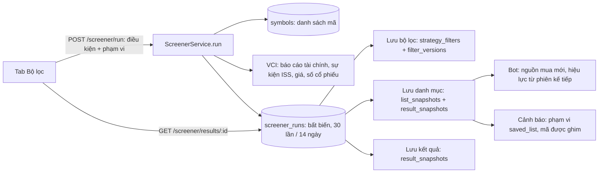

# IQX — Đặc tả Bộ lọc cổ phiếu (Stock Screener)

Ngày phân tích: **30/10/2026**. Mã nguồn tham chiếu: nhánh `main`, commit `f4bcf2d7` (working tree sạch lúc phân tích).

Tài liệu **mô tả ngược** (reverse-documentation) hành vi **đã triển khai hôm nay** của chức năng "Bộ lọc" (tab thứ ba của trang "Chiến lược"). Đây không phải yêu cầu về hành vi nên có. Mọi khẳng định được đọc từ mã nguồn; chỗ nào không chắc, tài liệu ghi rõ là **quan sát** hoặc **nghi ngờ**. Khi lập tài liệu không có dòng mã nào bị sửa; `mobile/` nằm ngoài phạm vi (đang tạm ngừng theo `AGENTS.md`). Một vài lệnh kiểm chứng hành vi validate của zod (chạy bằng `node -e` hoặc trong thư mục tạm) không ghi file nào vào repo.

## Quy ước đọc tài liệu

| Ký hiệu | Ý nghĩa |
| --- | --- |
| `path:line` | Bằng chứng trong mã nguồn, đường dẫn tính từ gốc repo; `BE` = `backend/`, `FE` = `frontend/`. Số dòng đúng tại commit nêu trên. |
| **QS-xx** | **Quan sát**: sự thật đọc từ mã, đáng lưu ý nhưng chưa chắc là lỗi. |
| **NN-xx** | **Nghi ngờ**: nghi là lỗi hoặc không nhất quán; suy luận từ mã, **chưa tái hiện** trên môi trường chạy. Danh sách đầy đủ ở mục 9.3. |
| **CKM** | **Chưa kiểm chứng**: cần dữ liệu thật hoặc nguồn ngoài (VCI, số liệu DB) mà mã không cho biết. |
| `ratio` | Đơn vị truyền qua API cho các chỉ tiêu phần trăm: 15% truyền là `0.15`. Giao diện chỉ đổi sang % ở `FE/src/pages/strategy/filter/units.ts`. |
| "run" | Một lần chạy bộ lọc, do máy chủ giữ (bảng `screener_runs`), định danh bằng `result_id`. |
| "danh mục" | Bản ghi `list_snapshots` (tập mã + bằng chứng của một kết quả). "Kết quả đã lưu" = `result_snapshots`. |

## Mục lục

1. Tổng quan và vị trí trong sản phẩm
2. Danh mục chỉ tiêu
3. Mô hình điều kiện
4. Phạm vi cổ phiếu, dữ liệu và kết quả
5. Lưu trữ
6. Tích hợp (Bot, cảnh báo, Học viện)
7. API
8. Giao diện
9. Hành vi biên, khác biệt so với spec gốc, nghi ngờ lỗi, độ phủ kiểm thử

---

## 1. Tổng quan và vị trí trong sản phẩm

### 1.1 Chức năng

Người dùng Premium chọn **thị trường** và **ngành**, thêm tối đa 42 **điều kiện chỉ tiêu cơ bản** (tăng trưởng, hiệu quả, nợ, dòng tiền, định giá, độ ổn định...), mỗi điều kiện có **kỳ tính riêng**, dấu so sánh `>` hoặc `<` và ngưỡng. Các điều kiện luôn nối bằng **AND**. Máy chủ lấy báo cáo tài chính mới nhất đã công bố của từng doanh nghiệp từ VCI, tính từng ô số liệu, đánh dấu doanh nghiệp "đạt" khi **mọi** điều kiện có trạng thái `ok` và thỏa ngưỡng, rồi **lưu nguyên kết quả phía máy chủ**. Giao diện chỉ đọc kết quả theo trang từ bản lưu đó.

Từ một kết quả, người dùng có thể: lưu **bộ lọc** (tiêu chí, có phiên bản), lưu **danh mục** (tập mã đạt cùng bằng chứng), lưu **kết quả** (các dòng số liệu đóng băng), **áp dụng cho Bot** (thay nguồn mua mới của Bot từ phiên giao dịch kế tiếp), hoặc tạo **cảnh báo** trên một danh mục. Chức năng **không** tạo lệnh giao dịch và không bán cổ phiếu đang giữ.

Điểm thiết kế xuyên suốt (có chú thích ngay trong mã, `FE/src/pages/strategy/filter/definition.ts:1-5`, `BE/src/modules/screener/screener.metrics.ts:48-61`):

- Một ô không `ok` (thiếu dữ liệu, không áp dụng, kỳ gốc không dương...) **không bao giờ là "đạt"** và không bao giờ bị thay bằng 0.
- Kỳ tính không bao giờ bị đổi âm thầm; bộ lọc cũ có kỳ không còn hỗ trợ bị chặn và yêu cầu chọn lại.
- Mọi trang của một kết quả dùng chung một mốc `as_of`; phân trang không tính lại.
- Tập mã của danh mục/kết quả đã lưu luôn lấy từ `run` do máy chủ giữ, **không** nhận danh sách mã từ trình duyệt (qua đường web).

### 1.2 Vị trí, quyền truy cập, cờ cấu hình

| Hạng mục | Giá trị hiện hành | Bằng chứng |
| --- | --- | --- |
| Route | `/chien-luoc?tab=bo-loc` (không có route `/bo-loc` riêng) | `FE/src/App.tsx:113` |
| Tab của trang Chiến lược | `canh-bao` (mặc định) \| `backtest` \| `bo-loc`; đổi tab ghi URL bằng `replace`; tab được dựng ở lần mở đầu rồi **giữ nguyên (ẩn)**, nên nháp/kết quả không mất khi qua lại | `FE/src/pages/strategy/strategy-page.tsx:25-83` |
| Nhãn điều hướng | "Chiến lược" | `FE/src/config/chrome.ts:43` |
| Tiêu đề trang | "Chiến lược" — "Theo dõi tín hiệu, kiểm thử chiến lược và sàng lọc doanh nghiệp." | `strategy-page.tsx:58` |
| Route cũ | `/canh-bao` và `/backtest` chuyển hướng về `/chien-luoc?tab=...` giữ nguyên query; **không** có chuyển hướng từ `/bo-loc` | `FE/src/App.tsx:114-115` |
| Lối vào khác | Học viện, nút "Mở Bộ lọc" → `/chien-luoc?tab=bo-loc` (`FE/src/pages/academy/navigation.ts:49`); cột "Mã" của kết quả → `/chien-luoc?tab=backtest&symbol=<MÃ>` | `results-panel.tsx:218-224` |
| Đăng nhập | Bắt buộc. API: 401 `AUTH_REQUIRED` "Yêu cầu đăng nhập" | `BE/src/modules/auth/auth.guard.ts` |
| Gói Premium | Bắt buộc. API: 403 `PREMIUM_REQUIRED` "Yêu cầu gói Premium đang hoạt động". Premium = có `billing_entitlement_grants` còn hiệu lực **hoặc** role admin | `BE/src/modules/auth/premium.guard.ts:17-45`, `FE/src/context/auth-provider.tsx:87-91,142` |
| Năng lực Học viện | Mỗi chỉ tiêu dùng trong điều kiện hoặc cột phải có capability `metric:<id>` (được cấp khi hoàn thành bài học tương ứng) | `BE/src/modules/screener/screener.service.ts:327-343` |
| Giới hạn tốc độ | Chỉ có giới hạn toàn cục 60 yêu cầu / 60 giây (429 + `Retry-After`); **không** có hạn mức riêng cho `POST /screener/run` | `BE/src/platform/config/environment.ts:86-87` |

**Cờ môi trường** (đọc ở `BE/src/platform/config/environment.ts`):

| Cờ | Mặc định | Tác động lên Bộ lọc |
| --- | --- | --- |
| `STRATEGY_V2_ENABLED` | `false` (`:230`) | Khi `false`, mọi route `/api/v2/strategy/screener*`, `/filters*`, `/lists*`, `/result-snapshots*` trả 404 `FEATURE_DISABLED`. Giao diện hiện "Tính năng chưa được bật" / "Trang Chiến lược mới chưa được bật trên máy chủ này. Dữ liệu của bạn vẫn được giữ nguyên; vui lòng quay lại sau." (`FE/src/pages/strategy/shared/ui-text.ts`) |
| `BOT_NEW_BUYS_ENABLED` | `false` (`:234`) | Không ảnh hưởng việc lọc/lưu/áp dụng nguồn mua; khi `false` Bot vẫn bán và ghi nhật ký mọi lệnh mua dự kiến là "skipped" (`candidate_order_unconfirmed`) |
| `ACADEMY_ENABLED` | `true` | Không được module screener đọc |
| `STRATEGY_ADVANCED_CAPABILITIES` | rỗng | Chỉ khóa năng lực backtest nâng cao, không liên quan Bộ lọc |
| `RATE_LIMIT_MAX` / `RATE_LIMIT_TTL_MS` | 60 / 60 000 ms | Giới hạn chung (xem 7.1) |

**Thứ tự chặn truy cập** (suy ra từ `BE/src/modules/auth/auth.module.ts:21-23` và các `@UseGuards` của controller): các guard toàn cục (`RateLimitGuard`, `ApiAuthGuard`, `RolesGuard`, `PremiumGuard`) chạy **trước**, sau đó guard cờ tính năng của controller (`ScreenerEnabledGuard` hoặc `SavedFiltersFeatureGuard`), rồi `ApiAuthGuard` + `PremiumGuard` của controller (nên `PremiumGuard` chạy hai lần). Hệ quả: khi `STRATEGY_V2_ENABLED=false`, người **không Premium** nhận 401/403 chứ không phải 404 (xem NN-11).

### 1.3 Bốn thao tác không được trộn lẫn

Mô tả này lấy từ chú thích đầu `filter-tab.tsx:1-11` và được các thông điệp UI lặp lại ("Bot không đổi").

| Thao tác (nút) | Lưu gì | Đổi Bot? | Điểm vào API | Bất biến? |
| --- | --- | --- | --- | --- |
| **Lưu bộ lọc** | Tiêu chí: điều kiện, kỳ của từng điều kiện, dấu, ngưỡng, phạm vi, cột tham khảo (định nghĩa 3.0). Mở lại thì tính lại bằng "báo cáo mới nhất đã công bố" tại thời điểm chạy | Không | `POST/PUT /api/v2/strategy/filters` | Mỗi phiên bản bất biến |
| **Lưu danh mục** | Tập mã đạt (hoặc tập con đã chọn) + bằng chứng của MỘT kết quả (`result_snapshot_id`, `run_id`, `provenance`) | Không | `POST /api/v2/strategy/lists/from-result` (`visibility: "saved"`) | Tập mã cố định |
| **Lưu kết quả** | Các dòng số liệu đóng băng của tập mã đã chọn: giá trị, trạng thái, kỳ thực tế, nguồn | Không | `POST /api/v2/strategy/result-snapshots` | Bất biến (trigger DB), chỉ xóa mềm |
| **Áp dụng cho Bot** | Tạo danh mục `internal` từ kết quả (nếu chưa lưu), rồi đặt làm nguồn mua mới của Bot, hiệu lực từ phiên giao dịch kế tiếp | Có, ở dạng "chờ hiệu lực" | `POST .../lists/from-result` (`visibility: "internal"`) rồi `POST /api/v2/bot/universe/apply-list` | Bản ghi thay đổi nguồn mua bất biến |

### 1.4 Luồng tổng quát



### 1.5 Bản đồ mã nguồn

| Lớp | Tệp | Vai trò |
| --- | --- | --- |
| BE chỉ tiêu | `BE/src/modules/screener/registry/fundamental-registry.json`, `screener.registry.ts` | Danh mục 42 chỉ tiêu, kỳ, đơn vị, tính sẵn sàng; nạp và kiểm tra bằng zod (`loadFundamentalRegistry`, `:154-174`) |
| BE công thức | `screener.metrics.ts` (công thức thuần), `screener.statements.ts` (chuẩn hóa báo cáo VCI → đối số công thức), `screener.shares.ts` (số cổ phiếu, EPS điều chỉnh) | Mục 2 |
| BE định nghĩa | `screener.definition.ts`, `screener.schemas.ts`, `registry/filter.schema.json` | Mục 3 |
| BE chạy | `screener.service.ts`, `screener.repository.ts`, `screener.controller.ts`, `screener-enabled.guard.ts` | Mục 4, 7 |
| BE lưu trữ | `BE/src/modules/saved-filters/*` (`saved-filters.service.ts`, `saved-results.service.ts`, `saved-filters.bot-usage.ts`, `saved-filters.schemas.ts`, `saved-filters.definition.ts`, `saved-filters.hash.ts`, controller, feature guard) | Mục 5 |
| BE tích hợp | `BE/src/modules/bots/bot-universe.*`, `bot.tradability.ts`, `BE/src/modules/alerts/strategy-alerts.*`, `BE/src/modules/strategy-config/strategy-config.calendar.ts` | Mục 6 |
| BE DB | `BE/migrations/0010_saved_filters.sql`, `0016_bot_policy_v1.sql`, `0019_strategy_v1.sql` | Mục 5.5 |
| FE | `FE/src/pages/strategy/filter/*` (`filter-tab.tsx`, `conditions.tsx`, `metric-library.tsx`, `catalog-dialog.tsx`, `results-panel.tsx`, `detail-dialogs.tsx`, `save-dialogs.tsx`, `saved-*-dialog.tsx`, `apply-bot-dialog.tsx`, `bot-source.tsx`, `definition.ts`, `units.ts`, `reasons.ts`, `api.ts`, `hooks.ts`, `types.ts`) và `FE/src/pages/strategy/{strategy-page.tsx,strategy-premium-gate.tsx,shared/*}` | Mục 8 |
| FE liên quan | `FE/src/pages/demo-trading/bot/universe/*` (`labels.ts`, `use-universe.ts`, `universe-dialogs.tsx`), `FE/src/pages/strategy/alerts/alert-form.tsx` | Mục 6 |
| Hợp đồng | `BE/contracts/openapi-v2.json` (sinh ra `FE/src/lib/generated/*`) | Mục 7 |

---

## 2. Danh mục chỉ tiêu

Nguồn sự thật của danh mục là `BE/src/modules/screener/registry/fundamental-registry.json` (phiên bản registry `iqx-fund-registry-2.1`, phiên bản tính `iqx-fund-2.0`; `screener.registry.ts:62-67`). Registry gồm **42 chỉ tiêu**: **37 `ready`** (chạy được) và **5 `data_unavailable`** (có định nghĩa nhưng thiếu nguồn dữ liệu). Mỗi chỉ tiêu chỉ có hai toán tử `>` và `<`. Hàm `loadFundamentalRegistry` (`screener.registry.ts:154-174`) kiểm tra id và thứ tự khớp `SCREENER_METRIC_IDS` (`:12-55`) và `default_period` thuộc `allowed_periods`.

### 2.1 Nguồn dữ liệu

Nhà cung cấp duy nhất là **VCI** (`SCREENER_DATA_SOURCE = 'VCI'`, `screener.service.ts:59`).

| Dữ liệu | Điểm gọi VCI | Dùng cho | Cache | Mã |
| --- | --- | --- | --- | --- |
| Báo cáo tài chính (3 lời gọi/mã: `BALANCE_SHEET`, `INCOME_STATEMENT`, `CASH_FLOW`; mỗi lời gọi trả cả năm lẫn quý) | `/v1/company/{symbol}/financial-statement?section=...` | Mọi chỉ tiêu | 300 giây | `BE/src/modules/market-data/providers/vci.provider.ts:365-380`; `screener.service.ts:414-426` |
| Sự kiện chia tách/thưởng/cổ tức bằng cổ phiếu (`eventCode=ISS`) | `/v1/events` | EPS điều chỉnh: `eps_yoy`, `eps_cagr3`, `eps_growth_stability`, `peg`, `pe`. Chỉ gọi khi điều kiện/cột có một trong các chỉ tiêu này | 6 giờ (tối đa 1000 dòng) | `vci.provider.ts:344-363`; `screener.service.ts:400-401,429-437` |
| Số cổ phiếu lưu hành theo vốn hóa (`number_of_shares_mkt_cap`, lấy dòng đầu `rows[0]` của báo cáo `ratio` kỳ Q) | statistics-financial | Chỉ tiêu cần vốn hóa (`PRICE_METRICS`) | 300 giây | `vci.provider.ts:390-402`; `screener.service.ts:439-450` |
| Giá (price board, mỗi nhóm 100 mã) | price board | `pe`, `pb`, `ps`, `ev_ebitda`, `fcf_yield`, `buyback_yield`, `peg` | 3 giây | `vci.provider.ts:177-215`; `screener.service.ts:366-384` |
| Danh sách mã, sàn, ngành | bảng `symbols` (PostgreSQL) | Phạm vi lọc | — | `screener.service.ts:345-363` |

Giá quan sát = `close_price` nếu có, nếu không thì `reference_price`; chỉ nhận giá > 0 (`screener.service.ts:374-375`). Không dùng giá lịch sử và không có nhà cung cấp dự phòng.

### 2.2 Ngữ nghĩa kỳ tính

Kỳ tính là thuộc tính của **từng điều kiện** (và từng cột tham khảo), một trong `quarter | ttm | year | three_year` (`screener.registry.ts:78`). Mỗi chỉ tiêu chỉ nhận các kỳ trong `allowed_periods` của nó (bảng 2.4).

| Kỳ (`id`) | Nhãn trên giao diện | Dòng chảy (doanh thu, lợi nhuận, CFO...) | Số dư đầu/cuối kỳ | Kỳ so sánh YoY | Nhãn kỳ thực tế của ô |
| --- | --- | --- | --- | --- | --- |
| `quarter` | "Quý gần nhất" (chỉ tiêu bảng cân đối `debt_equity`, `current_ratio`: "Số dư cuối quý gần nhất") | Quý rời rạc mới nhất đã công bố | Cuối = quý mới nhất; đầu = quý liền trước | Cùng quý năm trước | `Q3/2026` |
| `ttm` | "Bốn quý gần nhất" | Tổng **4 quý liên tiếp** kết thúc ở quý mới nhất; thiếu bất kỳ quý nào thì không có cửa sổ ("Chưa có báo cáo của kỳ cần dùng") | Cuối = quý mới nhất; đầu = quý cách 4 quý | TTM kết thúc 4 quý trước | `TTM Q3/2026` |
| `year` | "Năm tài chính gần nhất" ("Số dư cuối năm tài chính gần nhất" cho chỉ tiêu bảng cân đối) | Năm tài chính mới nhất đã công bố | Cuối = năm mới nhất; đầu = năm liền trước | Năm liền trước | `FY2025` |
| `three_year` | "Ba năm tài chính gần nhất" | Chuỗi 3–4 năm tài chính liên tiếp (CAGR cần 4 mốc; độ ổn định cần 3 hoặc 4 mốc) | — | — | `FY2022–FY2025` |

Nguồn: `screener.registry.ts:95-111` (nhãn), `screener.statements.ts:263-298` (`periodView`), `:421-762` (`derive`).

Quy tắc về "báo cáo mới nhất đã công bố" (`data_mode: "latest_disclosed"`):

1. **Giải quyết riêng cho từng công ty** tại `as_of`. Hai công ty có thể đang dùng hai quý khác nhau (một công ty đã công bố Q3, công ty kia mới có Q2). Nhãn kỳ thực tế được trả trong từng ô (`actual_period_label`) và hiện dưới giá trị (QS-01).
2. **Ngày công bố**: dùng `public_date` của VCI; nếu thiếu thì giả định hạn công bố pháp lý: quý + 45 ngày, năm tài chính + 90 ngày (`screener.statements.ts:122-136`). Một báo cáo chỉ được dùng khi ngày công bố (thật hoặc giả định) **nhỏ hơn** ngày lịch Việt Nam (UTC+7) của `as_of`, tức dùng được từ ngày Việt Nam kế tiếp (`:148,160`). `available_at` = 00:00 +07:00 của ngày kế tiếp ngày công bố mới nhất trong các báo cáo đã dùng (`:244-247`).
3. Chỉ nhận dòng VCI có `length_report = 5` (năm tài chính) hoặc `1..4` (quý); ba section được gộp theo khóa `năm:kỳ` (`:149-187`). `published_at` = ngày công bố lớn nhất, `updated_at` = `update_date` lớn nhất trong các section.
4. **Mẫu báo cáo tài chính** (ngân hàng, chứng khoán, bảo hiểm) được nhận ra khi báo cáo thu nhập có trường `isb*`, `iss*` hoặc `isi*` khác 0 (`:110-111,188-193`). Chỉ tiêu có `applicability = non_financial` của công ty đó trả `not_applicable` ("Không áp dụng cho ngân hàng, bảo hiểm, chứng khoán").
5. Ánh xạ trường VCI → khái niệm tại `screener.statements.ts:44-75` (xem bảng 2.5). Các dòng VCI ghi số âm cho khoản chi (giá vốn `isa4`, chi phí lãi vay `isa8`, thuế `isa19`, capex `cfa19`, chi mua lại cổ phiếu `cfa28`) được **đảo dấu** thành số dương (không dùng `abs()`).

### 2.3 Trạng thái ô và mã lý do

Một ô số liệu (`ScreenerMetricResult`, `screener.statements.ts:218-240`) có `status`, `value` (chỉ khác `null` khi `ok`), `unit` (đơn vị API), `lower_bound?`, `reason?`, `reason_code?`, `actual_period_label`, `comparison_period_label`, `published_at`, `available_at`, `source_revision`, `components[]`.

| `status` | Ý nghĩa | Tính "đạt"? | Nhãn giao diện (`units.ts:51-57`) | Giải thích giao diện (`units.ts:59-65`) |
| --- | --- | --- | --- | --- |
| `ok` | Có giá trị | Tùy ngưỡng | (hiện số) | — |
| `missing` | Thiếu báo cáo, thành phần hoặc nhà cung cấp lỗi | Không | "Chưa đủ dữ liệu" | "Thiếu báo cáo hoặc một thành phần của kỳ cần dùng. Không được coi là đạt." |
| `not_applicable` | Chỉ tiêu không áp dụng cho loại doanh nghiệp | Không | "Không áp dụng" | "Chỉ tiêu không áp dụng cho loại doanh nghiệp này. Không được coi là đạt." |
| `insufficient_base` | Kỳ gốc hoặc mẫu số không dương | Không | "Không tính được" | "Kỳ gốc hoặc mẫu số không dương nên không có tỷ số thông thường. Không được coi là đạt." |
| `definition_pending` | Chưa có định nghĩa được duyệt | Không | "Chờ định nghĩa" | "Chỉ tiêu chưa có định nghĩa được duyệt nên chưa chạy được." |
| `data_unavailable` | Có định nghĩa nhưng nguồn chưa cung cấp đủ đầu vào | Không | "Chưa có nguồn dữ liệu" | "Chỉ tiêu đã có định nghĩa nhưng nguồn dữ liệu chưa cung cấp đủ đầu vào." |

`lower_bound = true` chỉ xuất hiện ở chỉ tiêu chuỗi (streak) khi **toàn bộ** lịch sử có sẵn đều dương: giá trị là cận dưới (hiển thị "≥ n"; tooltip "Toàn bộ lịch sử có sẵn đều dương: giá trị thật tối thiểu bằng số này."). Ô như vậy có thể thỏa `>` nhưng **không bao giờ thỏa `<`** (`screener.service.ts:72-84`).

Mã lý do (`reason_code`) suy ra bằng cách đối chiếu chuỗi `reason` với bảng `METRIC_REASONS` (`screener.metrics.ts:90-105,131-154`); không khớp thì `reason_code` = chính `status`.

| `reason_code` | Chuỗi `reason` (máy chủ) | Có nhãn trong `reasons.ts`? |
| --- | --- | --- |
| `missing_input` | Thiếu dữ liệu đầu vào | Có |
| `non_positive_base` | Kỳ gốc không dương — không đủ cơ sở tính tăng trưởng thông thường | Có ("Kỳ gốc không dương") |
| `non_positive_point` | Có mốc năm không dương — không đủ cơ sở tính CAGR | Có ("Có mốc năm không dương") |
| `non_positive_denominator` | Mẫu số không dương — không diễn giải như tỷ số thông thường | Có ("Mẫu số không dương") |
| `invalid_price` | Giá không hợp lệ | Có |
| `no_interest_expense` | Không phát sinh chi phí lãi vay | Có |
| `financial_sector` | Không áp dụng cho ngân hàng, bảo hiểm, chứng khoán | Có |
| `insufficient_history` | Chưa đủ lịch sử báo cáo liên tục | Có |
| `provider_error` | Nguồn dữ liệu tài chính tạm thời không khả dụng | Có |
| `price_unavailable` | Chưa có giá giao dịch hợp lệ | Có |
| `shares_unavailable` | Chưa có số cổ phiếu lưu hành | Có |
| `no_report` | Chưa có báo cáo của kỳ cần dùng | Có |
| `low_eps_growth` | Tăng trưởng EPS dưới 5% — PEG không có ý nghĩa | **Không** (NN-01) |
| `share_history_unavailable` | Chưa có lịch sử số cổ phiếu đã điều chỉnh tách/thưởng | **Không** (NN-01) |

Hàm hiển thị `reasonLabel(code)` (`FE/.../reasons.ts:19-21`) trả nhãn trong bảng, nếu không thì nhãn trạng thái cùng tên, nếu không nữa thì in nguyên mã thô.

### 2.4 Bảng 42 chỉ tiêu

Chú giải: kỳ **Q** = `quarter`, **TTM** = `ttm`, **Y** = `year`, **3Y** = `three_year`. "Phi tài chính" = `applicability: non_financial` (ngân hàng, bảo hiểm, chứng khoán nhận `not_applicable`); "Mọi DN" = `all`. Tên tiếng Việt là trường `name` của registry (nhiều chỉ tiêu mang tên tiếng Anh). "Chương" lấy từ trường `chapter`: 8 Tốc độ tăng trưởng, 9 Độ ổn định, 10 Hiệu quả và biên lợi nhuận, 11 Nợ và khả năng thanh toán, 12 Dòng tiền, 13 Định giá (`BE/src/modules/academy/content/v3/catalog.json`). Cột "Bài học" là `lesson_id`; dấu "—" nghĩa là chỉ tiêu **không có bài học** (xem 2.8).

| # | `id` | Tên hiển thị | Chương · Bài học | Đơn vị UI / API | Kỳ mặc định | Kỳ cho phép | Áp dụng | Sẵn sàng |
| --- | --- | --- | --- | --- | --- | --- | --- | --- |
| 1 | `revenue_yoy` | Tăng trưởng doanh thu YoY | 8 · ch08-l01 | % / ratio | Q | Q, TTM, Y | Phi tài chính | ready |
| 2 | `profit_yoy` | Tăng trưởng LNST YoY | 8 · ch08-l02 | % / ratio | Q | Q, TTM, Y | Mọi DN | ready |
| 3 | `eps_yoy` | Tăng trưởng EPS YoY | 8 · ch08-l03 | % / ratio | Q | Q, TTM, Y | Mọi DN | ready |
| 4 | `gross_margin` | Biên lợi nhuận gộp | 10 · ch10-l04 | % / ratio | TTM | TTM, Q, Y | Phi tài chính | ready |
| 5 | `net_margin` | Biên lợi nhuận ròng | 10 · ch10-l05 | % / ratio | TTM | TTM, Q, Y | Phi tài chính | ready |
| 6 | `roe` | ROE | 10 · ch10-l01 | % / ratio | TTM | TTM, Y | Mọi DN | ready |
| 7 | `roa` | ROA | 10 · ch10-l02 | % / ratio | TTM | TTM, Y | Mọi DN | ready |
| 8 | `roic` | ROIC | 10 · ch10-l03 | % / ratio | TTM | TTM | Phi tài chính | ready |
| 9 | `debt_equity` | D/E (Nợ vay / Vốn chủ sở hữu) | 11 · ch11-l01 | lần / lần | Q | Q, Y | Phi tài chính | ready |
| 10 | `net_debt_ebitda` | Net Debt / EBITDA | 11 · ch11-l04 | lần / lần | TTM | TTM, Y | Phi tài chính | ready |
| 11 | `current_ratio` | Current Ratio | 11 · ch11-l02 | lần / lần | Q | Q, Y | Phi tài chính | ready |
| 12 | `interest_coverage` | Interest Coverage | 11 · ch11-l03 | lần / lần | TTM | TTM, Q, Y | Phi tài chính | ready |
| 13 | `cfo_margin` | CFO Margin | 12 · ch12-l01 | % / ratio | TTM | TTM, Q, Y | Phi tài chính | ready |
| 14 | `cfo_profit` | CFO / LNST | 12 · ch12-l02 | lần / lần | TTM | TTM, Q, Y | Phi tài chính | ready |
| 15 | `fcf_margin` | FCF Margin | 12 · ch12-l04 | % / ratio | TTM | TTM, Q, Y | Phi tài chính | ready |
| 16 | `fcf_yoy` | FCF Growth YoY | 8 · — | % / ratio | TTM | TTM, Q, Y | Phi tài chính | ready |
| 17 | `capex_revenue` | Capex / Revenue | 12 · ch12-l03 | % / ratio | TTM | TTM, Q, Y | Phi tài chính | ready |
| 18 | `accrual` | Accrual Ratio | 8 · — | % / ratio | TTM | TTM, Y | Phi tài chính | ready |
| 19 | `pe` | P/E | 13 · ch13-l01 | lần / lần | TTM | TTM, Y | Mọi DN | ready |
| 20 | `pb` | P/B | 13 · ch13-l02 | lần / lần | TTM | TTM, Y | Mọi DN | ready |
| 21 | `ps` | P/S | 13 · ch13-l03 | lần / lần | TTM | TTM, Y | Phi tài chính | ready |
| 22 | `ev_ebitda` | EV / EBITDA | 13 · ch13-l05 | lần / lần | TTM | TTM, Y | Phi tài chính | ready |
| 23 | `peg` | PEG | 13 · ch13-l04 | lần / lần | TTM | TTM | Mọi DN | ready |
| 24 | `fcf_yield` | FCF Yield | 13 · ch13-l06 | % / ratio | TTM | TTM, Y | Phi tài chính | ready |
| 25 | `revenue_cagr3` | Revenue CAGR 3Y | 8 · ch08-l04 | % / ratio | 3Y | 3Y | Phi tài chính | ready |
| 26 | `profit_cagr3` | Net Profit CAGR 3Y | 8 · ch08-l05 | % / ratio | 3Y | 3Y | Mọi DN | ready |
| 27 | `eps_cagr3` | EPS CAGR 3Y | 8 · ch08-l06 | % / ratio | 3Y | 3Y | Mọi DN | ready |
| 28 | `asset_turnover` | Asset Turnover | 10 · ch10-l06 | lần / lần | TTM | TTM, Y | Phi tài chính | ready |
| 29 | `ccc` | Cash Conversion Cycle | 10 · ch10-l07 | ngày / ngày | Y | Y | Phi tài chính | ready |
| 30 | `working_cap_turnover` | Working Capital Turnover | 11 · — | lần / lần | TTM | TTM, Y | Phi tài chính | ready |
| 31 | `revenue_growth_stability` | Revenue Growth Stability | 9 · ch09-l02 | điểm % / ratio | 3Y | 3Y | Phi tài chính | ready |
| 32 | `eps_growth_stability` | EPS Stability | 9 · ch09-l04 | điểm % / ratio | 3Y | 3Y | Mọi DN | ready |
| 33 | `net_margin_stability` | Margin Stability | 9 · ch09-l03 | điểm % / ratio | 3Y | 3Y | Phi tài chính | ready |
| 34 | `roic_stability` | ROIC Stability | 9 · ch09-l05 | điểm % / ratio | 3Y | 3Y | Phi tài chính | ready |
| 35 | `fcf_positive_streak` | FCF Positive Streak | 12 · ch12-l05 | năm / năm | Y | Y | Phi tài chính | ready |
| 36 | `profit_positive_streak` | Profit Positive Streak | 9 · ch09-l01 | năm / năm | Y | Y | Mọi DN | ready |
| 37 | `dividend_yield` | Dividend Yield | 13 · — | % / ratio | TTM | TTM | Mọi DN | **data_unavailable** |
| 38 | `payout_ratio` | Payout Ratio | 13 · — | % / ratio | TTM | TTM | Mọi DN | **data_unavailable** |
| 39 | `dividend_cagr3` | Dividend Growth | 13 · — | % / ratio | 3Y | 3Y | Mọi DN | **data_unavailable** |
| 40 | `share_count_yoy` | Share Count Growth | 13 · — | % / ratio | Q | Q | Mọi DN | **data_unavailable** |
| 41 | `buyback_yield` | Buyback Yield | 13 · — | % / ratio | TTM | TTM, Y | Mọi DN | ready |
| 42 | `shareholder_yield` | Shareholder Yield | 13 · — | % / ratio | TTM | TTM | Mọi DN | **data_unavailable** |

Số liệu tổng hợp: 6 chỉ tiêu chương 8 có bài học (#1–3, #25–27) + #16, #18 không bài học; chương 9: 5; chương 10: 7; chương 11: 4 có bài học + #30; chương 12: 5; chương 13: 6 có bài học (#19–24) + 6 không bài học (#37–42). Tổng **33 chỉ tiêu có bài học** (đúng bằng tổng bài của chương 8–13: 6+5+7+4+5+6) và **9 chỉ tiêu không bài học**.

Năm chỉ tiêu `data_unavailable` (lý do trả về cho người dùng, `screener.metrics.ts:107-118`):

| Chỉ tiêu | Lý do |
| --- | --- |
| `dividend_yield`, `payout_ratio`, `dividend_cagr3` | "Chưa có nguồn cổ tức tiền mặt mỗi cổ phiếu theo ngày giao dịch không hưởng quyền đã điều chỉnh." |
| `shareholder_yield` | Câu trên + " Shareholder Yield cần Dividend Yield." |
| `share_count_yoy` | "Chưa có hồ sơ sự kiện tách/gộp/thưởng cổ phiếu để điều chỉnh số cổ phiếu cùng kỳ." |

Các chỉ tiêu này `supported = false` trong `GET /screener/metrics`; nếu cố chạy thì bị chặn `METRIC_NOT_READY` (xem 3.4). Ngay cả khi lọt vào `evaluateScreenerMetric`, kết quả là `data_unavailable` (hoặc `definition_pending` nếu registry ghi như vậy) (`screener.statements.ts:371-379`).

### 2.5 Công thức theo mã

Ký hiệu: Σ(kỳ) = tổng giá trị của các quý/năm trong cửa sổ kỳ đã chọn (2.2); "bình quân" = (cuối kỳ + đầu kỳ) / 2, **cần cả hai đầu** (thiếu một đầu thì ô `missing`); P = giá, S = số cổ phiếu VCI (`number_of_shares_mkt_cap`), vốn hóa = P × S. Công thức chung `calculateMetric` (`screener.metrics.ts:286-330`): số chia ≤ 0 thì `insufficient_base` / "Mẫu số không dương", trừ các trường hợp ghi riêng. Khái niệm → trường VCI (`screener.statements.ts:44-75`):

| Khái niệm | Trường VCI | Khái niệm | Trường VCI |
| --- | --- | --- | --- |
| `revenue` | `isa3` | `current_assets` | `bsa1` |
| `cogs` (đảo dấu) | `isa4` | `cash` | `bsa2` |
| `gross_profit` | `isa5` | `st_investments` | `bsa5` |
| `interest_expense` (đảo dấu) | `isa8` | `receivables` | `bsa9` |
| `pbt` | `isa16` | `inventory` | `bsa15` |
| `income_tax` (đảo dấu) | `isa19` | `total_assets` | `bsa53` |
| `npat` (LNST hợp nhất) | `isa20` | `current_liabilities` | `bsa55` |
| `npat_parent` (LNST cổ đông công ty mẹ) | `isa22` | `st_debt` | `bsa56` |
| `depreciation` | `cfa2` | `payables` | `bsa57` |
| `goodwill_amortization` | `cfa103` | `lt_debt` | `bsa71` |
| `cfo` | `cfa18` | `equity` | `bsa78` |
| `capex` (đảo dấu) | `cfa19` | `charter_capital` | `bsa80` |
| `share_issuance` | `cfa27` | `preferred_equity` | `bsa174` |
| `share_buyback` (đảo dấu) | `cfa28` | `nci` | `bsa210` |

| Nhóm | Chỉ tiêu | Công thức theo mã (`screener.statements.ts:421-762`) | Trạng thái đặc biệt |
| --- | --- | --- | --- |
| Tăng trưởng YoY | `revenue_yoy` | Σrevenue(kỳ) / Σrevenue(kỳ so sánh) − 1 | Kỳ gốc ≤ 0 → `insufficient_base` (`non_positive_base`); thiếu cửa sổ → `missing` (`no_report`) |
| | `profit_yoy` | Σnpat_parent(kỳ) / Σnpat_parent(kỳ so sánh) − 1 | như trên |
| | `eps_yoy` | EPS điều chỉnh(kỳ) / EPS điều chỉnh(kỳ so sánh) − 1 (xem 2.6) | Không có lịch sử số cổ phiếu → `missing` (`share_history_unavailable`) |
| | `fcf_yoy` | FCF(kỳ) / FCF(kỳ so sánh) − 1, FCF = Σcfo − Σcapex | như `revenue_yoy` |
| CAGR 3 năm | `revenue_cagr3`, `profit_cagr3` (npat_parent), `eps_cagr3` (EPS điều chỉnh năm) | (giá trị năm mới nhất / giá trị 3 năm trước)^(1/3) − 1; cần 4 năm tài chính liên tiếp có báo cáo | Thiếu năm → `missing` (`insufficient_history`); có mốc ≤ 0 → `insufficient_base` (`non_positive_point`) |
| Biên và dòng tiền | `gross_margin` | Σgross_profit / Σrevenue | Chia ≤ 0 → `insufficient_base` |
| | `net_margin` | Σnpat / Σrevenue (LNST **hợp nhất**) | như trên |
| | `cfo_margin` | Σcfo / Σrevenue | như trên |
| | `cfo_profit` | Σcfo / Σnpat (hợp nhất) | LNST ≤ 0 → `insufficient_base` |
| | `fcf_margin` | (Σcfo − Σcapex) / Σrevenue | như trên |
| | `capex_revenue` | Σcapex / Σrevenue | như trên |
| Sinh lời | `roe` | Σnpat_parent / bình quân(equity − nci − preferred_equity) | Thiếu `nci` hoặc `preferred_equity` ở một đầu thì `missing` (xem NN-16) |
| | `roa` | Σnpat / bình quân(total_assets) | |
| | `roic` | NOPAT / bình quân(vốn đầu tư). NOPAT = (pbt + interest_expense) × (1 − t); t = income_tax / pbt kẹp trong [0; 0,5], pbt ≤ 0 thì t = 20%. Vốn đầu tư (từng đầu) = equity + st_debt + lt_debt − cash. Chỉ kỳ TTM | `screener.statements.ts:317-348` |
| Hiệu quả vận hành | `accrual` | (Σnpat − Σcfo) / bình quân(total_assets) | |
| | `asset_turnover` | Σrevenue / bình quân(total_assets) | |
| | `working_cap_turnover` | Σrevenue / bình quân(current_assets − current_liabilities) | Vốn lưu động bình quân ≤ 0 → `insufficient_base` |
| | `ccc` | DIO + DSO − DPO; DIO = bình quân(inventory) / cogs × 365; DSO = bình quân(receivables) / revenue × 365; DPO = bình quân(payables) / cogs × 365. Dùng năm tài chính mới nhất và năm liền trước | Thiếu đầu vào → `missing`; revenue ≤ 0 hoặc cogs ≤ 0 → `insufficient_base`; thiếu 2 năm liên tiếp → `insufficient_history` |
| Nợ và thanh toán | `debt_equity` | (st_debt + lt_debt) / equity tại cuối kỳ (số dư) | equity ≤ 0 → `insufficient_base` |
| | `current_ratio` | current_assets / current_liabilities tại cuối kỳ | |
| | `net_debt_ebitda` | (st_debt + lt_debt − (cash + st_investments)) / EBITDA; EBITDA = pbt + interest_expense + depreciation + goodwill_amortization (thiếu goodwill coi là 0) | EBITDA ≤ 0 → `insufficient_base`. Nợ ròng âm (dư tiền) vẫn là `ok` với giá trị âm |
| | `interest_coverage` | (pbt + interest_expense) / interest_expense | interest_expense = 0 → `not_applicable` (`no_interest_expense`); < 0 → `insufficient_base` |
| Định giá | `pe` | P / EPS điều chỉnh (TTM = tổng 4 quý; Y = EPS năm). Nếu **không** dựng được EPS điều chỉnh: P / (Σnpat_parent / S) | Giá thiếu hoặc ≤ 0 → `missing` (`price_unavailable`); EPS ≤ 0 (doanh nghiệp lỗ) → `insufficient_base` (`non_positive_denominator`) |
| | `pb` | (P × S) / (equity − nci − preferred_equity) tại cuối kỳ | thiếu S → `missing` (`shares_unavailable`) |
| | `ps` | (P × S) / Σrevenue | |
| | `ev_ebitda` | (P × S + preferred_equity + (st_debt + lt_debt) + nci − (cash + st_investments)) / EBITDA | |
| | `peg` | PE / (eps_yoy × 100), PE = P / EPS TTM | 0 < eps_yoy < 5% → `insufficient_base` (`low_eps_growth`); eps_yoy ≤ 0 hoặc PE ≤ 0 → `insufficient_base` (`non_positive_base` / `non_positive_denominator`) |
| | `fcf_yield` | (Σcfo − Σcapex) / (P × S) | |
| | `buyback_yield` | (Σshare_buyback − Σshare_issuance) / (P × S) | |
| Độ ổn định (độ lệch chuẩn tổng thể, chia cho **3**) | `revenue_growth_stability` | stdev của 3 tăng trưởng doanh thu YoY liên tiếp (cần 4 năm) | Một tăng trưởng không `ok` thì ô mang trạng thái của tăng trưởng đó |
| | `eps_growth_stability` | stdev của 3 tăng trưởng EPS điều chỉnh (cần 4 năm) | cần lịch sử số cổ phiếu |
| | `net_margin_stability` | stdev của biên lợi nhuận ròng 3 năm (npat / revenue) | |
| | `roic_stability` | stdev của ROIC 3 năm (cần 4 năm vì ROIC dùng bình quân đầu/cuối) | |
| Chuỗi | `fcf_positive_streak` | Số năm tài chính liên tiếp gần nhất có (cfo − capex) > 0 | Chuỗi dừng ở năm đầu tiên ≤ 0 **hoặc thiếu báo cáo**; nếu toàn bộ lịch sử có sẵn dương thì `lower_bound` |
| | `profit_positive_streak` | Như trên với npat_parent | |

Ghi chú:
- **QS-02**: cơ sở lợi nhuận không đồng nhất giữa các chỉ tiêu: `profit_yoy`, `profit_cagr3`, `roe`, `profit_positive_streak` dùng LNST của **cổ đông công ty mẹ** (`isa22`); `net_margin`, `roa`, `cfo_profit`, `accrual`, `net_margin_stability` dùng LNST **hợp nhất** (`isa20`). Đúng với công thức trong registry nhưng nên biết khi so sánh.
- **QS-06**: mã lý do `invalid_price` (`calculateMetric` khi giá ≤ 0) thực tế **không đạt được** qua luồng chạy, vì `derive` đã trả `price_unavailable` trước khi gọi công thức (`screener.statements.ts:495-496,668-669`); mã này chỉ xuất hiện trong kiểm thử đơn vị.
- Phần nhãn "Công thức" trong registry (`formula`) là văn bản mô tả (ví dụ "Lợi nhuận sau thuế hợp nhất / Doanh thu thuần × 100"); mã thực thi nằm ở `screener.statements.ts`. Quy ước null/âm của từng loại nằm ở trường `null_policy`.

### 2.6 Số cổ phiếu và EPS điều chỉnh (`screener.shares.ts`)

- **Mệnh giá** 10.000 đồng (`PAR_VALUE_VND`, `:24`); số cổ phiếu cuối kỳ thô = `charter_capital` (VCI `bsa80`, đồng) / 10.000 (`rawShares`, `:84-87`). Cổ phiếu quỹ **không** được trừ (VCI không tách dòng này).
- **Sự kiện điều chỉnh** (`shareEventsFromVci`, `:48-72`): chỉ lấy dòng `event_code = ISS` có ngày GDKHQ (`exright_date`) không sau ngày Việt Nam của `as_of`, tiêu đề được `parseStockTitle` nhận là `stock_dividend` (chia tách/thưởng/cổ tức bằng cổ phiếu) và `exercise_ratio > 0`; bỏ dòng trùng theo khóa `ngày:tỷ lệ`. Quyền mua, ESOP, phát hành riêng lẻ, hoán đổi **không** điều chỉnh hồi tố (có tiền/tài sản vào).
- **Điều chỉnh hồi tố** (`adjustedQuarterShares`, `:93-121`): số cổ phiếu cuối quý nhân (1 + tỷ lệ) của mọi sự kiện có ngày GDKHQ sau cuối quý; riêng quý đầu tiên chứa ngày GDKHQ chỉ nhân khi vốn góp chưa tăng (thấp hơn quý trước × (1 + tỷ lệ/2)).
- **EPS quý** = npat_parent / bình quân(số cổ phiếu đầu quý, cuối quý) đã điều chỉnh (quý đầu chuỗi dùng số cuối quý); **EPS 4 quý / EPS năm = tổng EPS của các quý** (`withShareHistory`, `:128-161`; năm cần đủ 4 quý có EPS).
- Nếu lấy sự kiện thất bại (`events = null`) thì **không dựng EPS**: `eps_yoy`, `eps_cagr3`, `eps_growth_stability`, `peg` trả `missing` (`share_history_unavailable`), còn `pe` quay về nhánh dự phòng P / (Σnpat_parent / S) (`screener.statements.ts:555-556,663-675`). Nếu lấy thành công nhưng danh sách rỗng, EPS vẫn được dựng từ vốn góp / mệnh giá (QS-03).

### 2.7 Toán tử, miền giá trị và chuyển đổi đơn vị

| Nội dung | Hành vi | Bằng chứng |
| --- | --- | --- |
| Toán tử | Chỉ `>` và `<`, so sánh **chặt**; `null`/ô không `ok` không bao giờ đạt; `lower_bound` chỉ thỏa `>` | `screener.service.ts:76-84`, `screener.schemas.ts:46-56` |
| Miền ngưỡng | `value` là số hữu hạn bất kỳ (kể cả âm); **không có min/max** theo chỉ tiêu | `screener.schemas.ts:46-56`; FE `units.ts:32-37` |
| Đơn vị API | `ratio`, `lần`, `ngày`, `năm` (`SCREENER_API_UNITS`); đơn vị của rule phải trùng `api_unit` của chỉ tiêu | `screener.registry.ts:59`; `screener.definition.ts:67-118` |
| Quy ước % | `%` và `điểm %` đi qua API ở dạng ratio (15% = 0,15). Nhập 15 → gửi 0,15; hiển thị 0,15 → "15" | `FE/.../units.ts:23-29` |
| Làm tròn nhập/xuất | `clean()` làm tròn 12 chữ số có nghĩa (`toPrecision(12)`) để tránh nhiễu dấu phẩy động; so sánh/xếp thứ tự dùng giá trị chưa làm tròn | `units.ts:12-17` |
| Nhập liệu | `parseDisplayInput` bỏ khoảng trắng, đổi dấu phẩy đầu tiên thành dấu chấm, chấp nhận dấu `+`/`-`, regex `^[-+]?(\d+\.?\d*|\.\d+)$`; chuỗi rỗng/không hợp lệ → `null` ("Nhập ngưỡng cho “…”.") | `units.ts:31-37` |
| Hiển thị | `Intl.NumberFormat("vi-VN", {maximumFractionDigits: 2})`; `null`/NaN → "—"; ngưỡng đã lưu hiện lại bằng dấu phẩy thập phân | `units.ts:39-48` |
| Đơn vị trên ô nhập | `metric.unit` ("%", "điểm %", "lần", "ngày", "năm") hiện bên phải ô Ngưỡng | `conditions.tsx:142` |
| Hàm BE `displayToApi` | Có trong `screener.metrics.ts:333-335` (đổi `%`/`điểm %` chia 100) nhưng **không được luồng chạy dùng** (chỉ định nghĩa; QS-04) | tìm kiếm `grep displayToApi BE/src` |

### 2.8 Chỉ tiêu nào người dùng thấy và dùng được

`GET /screener/metrics` (`screener.service.ts:188-212`) trả danh mục đã lọc theo **từng người dùng**:

1. Chỉ trả chỉ tiêu có `lesson_id ≠ null` **hoặc** người dùng có capability `metric:<id>` (quyết định HV-03, `docs/update-22-10/spec-update-22-10.md:233-240`). Chín chỉ tiêu không bài học bị ẩn, trừ người từng có grant cũ `fundamental:*` (được đổi thành `metric:<id>` tại `academy-grants.service.ts:31-75`). Bốn trong chín chỉ tiêu ẩn này **đã `ready`** (`fcf_yoy`, `accrual`, `working_cap_turnover`, `buyback_yield`) nhưng gần như không ai dùng được (QS-05).
2. Mỗi dòng có `learned` (= có capability `metric:<id>`), `supported` (= `readiness === 'ready'`), `unsupported_reason`. **Dùng được** khi `learned && supported && readiness === 'ready'` (`FE/.../definition.ts:18-20`).
3. Capability được cấp khi hoàn thành bài học tương ứng (33 mã `unlock` loại `fundamental` trong `academy/content/v3/schema.ts:1263-1301`). Tiền tố `metric:` ở `academy.capabilities.ts`.
4. Khi chạy, **mọi** chỉ tiêu trong điều kiện **và** cột tham khảo phải được mở; thiếu thì 403 `CAPABILITY_LOCKED` (mục 3.4).
5. Giao diện: thư viện bên trái chỉ liệt kê chỉ tiêu `learned`; chỉ tiêu chưa mở chỉ hiện trong hộp thoại "Danh mục N chỉ tiêu" kèm bài học cần học (mục 8.3 và 8.6). Với người dùng thường `N = 33`.

---

## 3. Mô hình điều kiện

### 3.1 Định nghĩa bộ lọc 3.0

Mô hình hiện hành là **định nghĩa 3.0**: kỳ nằm trên **từng điều kiện**, không còn kỳ chung của cả bộ lọc. Schema zod ở `BE/src/modules/screener/screener.schemas.ts:46-86` (tài liệu JSON Schema tương ứng: `registry/filter.schema.json`). Đối tượng là `strict`: khóa lạ bị từ chối.

| Trường | Kiểu / giá trị | Bắt buộc | Ràng buộc |
| --- | --- | --- | --- |
| `schema_version` | `"3.0"` | Có | Hằng; thiếu hoặc khác thì rơi vào nhánh `invalid_union` (xem 3.6) |
| `name` | chuỗi | Có | 1–120 ký tự (không `trim` ở schema chạy) |
| `logic` | `"AND"` | Có | Hằng; không có OR |
| `data_mode` | `"latest_disclosed"` | Không (mặc định như vậy) | Hằng |
| `rules[]` | mảng | Có (có thể rỗng) | Tối đa **42** phần tử (`SCREENER_MAX_RULES`) |
| `rules[].id` | chuỗi | Có | 1–64 ký tự; giao diện dùng `crypto.randomUUID()` |
| `rules[].metric_id` | enum 42 id | Có | Một chỉ tiêu chỉ xuất hiện **một lần** trong `rules` + `columns` |
| `rules[].period` | `quarter\|ttm\|year\|three_year` | Có | Phải thuộc `allowed_periods` của chỉ tiêu |
| `rules[].operator` | `">"` \| `"<"` | Có | Phải thuộc `operators` của chỉ tiêu (hiện đều là cả hai) |
| `rules[].value` | số | Có | Số hữu hạn, không giới hạn miền; đơn vị API (ratio cho %) |
| `rules[].api_unit` | `ratio\|lần\|ngày\|năm` | Có | Phải bằng `api_unit` của chỉ tiêu |
| `columns[]` | mảng `{metric_id, period}` | Không | Tối đa **12** (`SCREENER_MAX_COLUMNS`); chỉ để hiển thị, không quyết định đạt/không đạt |
| `scope.market` | chuỗi | Có | `all` hoặc `HOSE`/`HNX`/`UPCOM`/`HSX`, không phân biệt hoa thường |
| `scope.sector` | chuỗi | Có | Tối đa 200 ký tự; rỗng hoặc `all` = mọi ngành |

Ví dụ định nghĩa gửi lên `POST /api/v2/strategy/screener/run`:

```json
{
  "schema_version": "3.0",
  "name": "Bộ lọc chưa lưu",
  "logic": "AND",
  "data_mode": "latest_disclosed",
  "rules": [
    { "id": "0f9c…", "metric_id": "roe", "period": "ttm", "operator": ">", "value": 0.15, "api_unit": "ratio" },
    { "id": "7ab2…", "metric_id": "debt_equity", "period": "quarter", "operator": "<", "value": 1, "api_unit": "lần" }
  ],
  "columns": [ { "metric_id": "revenue_yoy", "period": "quarter" } ],
  "scope": { "market": "HOSE", "sector": "all" }
}
```

Không có ngày/`as_of` do máy khách gửi: máy chủ tự chốt mốc dữ liệu (`screener.schemas.ts:61-65`).

### 3.2 Giới hạn tổng hợp

| Giới hạn | Giá trị | Nơi áp dụng |
| --- | --- | --- |
| Số điều kiện tối đa | 42 (thực tế bằng số chỉ tiêu vì không được trùng) | zod `rules.max(42)`; giao diện không có trần riêng |
| Số cột tham khảo tối đa | 12 (máy chủ); giao diện tự thêm tối đa **6** (`MAX_REFERENCE_COLUMNS`, `definition.ts:13`) | `screener.schemas.ts:22,74` |
| Độ dài tên bộ lọc | 1–120 | zod; giao diện cắt `slice(0, 120)` (`definition.ts:65`) |
| Độ dài ngành | ≤ 200 | zod; ô nhập `maxLength=200` (`conditions.tsx:50`) |
| Số doanh nghiệp xét mỗi lần | 500 (`SCREENER_MAX_UNIVERSE`) | `screener.schemas.ts:16`, xem 4.2 |
| Chạy song song | 4 doanh nghiệp cùng lúc (`SCREENER_FETCH_CONCURRENCY`) | `screener.schemas.ts:18` |
| Phân trang kết quả | `offset ≥ 0` (mặc định 0), `limit` 1–500 (mặc định 100); giao diện dùng 50/trang | `screener.schemas.ts:286-293`, `api.ts:25` |

### 3.3 Logic đánh giá

- Doanh nghiệp **đạt** khi **mọi** điều kiện: ô của chỉ tiêu đó có `status = ok` **và** thỏa so sánh chặt (`>` hoặc `<`) với ngưỡng (`rulePasses`, `screener.service.ts:76-84`; `passed = definition.rules.every(...)`, `:266-268`). Ô `lower_bound` chỉ thỏa `>`.
- Ô không `ok` (thiếu dữ liệu, không áp dụng, kỳ gốc không dương, chưa có nguồn...) **làm doanh nghiệp không đạt** nhưng được thống kê riêng là "điều kiện không tính được" (`with_required_exceptions`), tách khỏi "không đạt ngưỡng" (`failed_threshold`) (`summarizeRows`, `:114-175`).
- Cột tham khảo (`columns`) **không** ảnh hưởng `passed`; một cột tham khảo thiếu số liệu không loại doanh nghiệp (thông điệp trong hộp thoại chất lượng dữ liệu, `detail-dialogs.tsx:150-151`).
- **Không có điều kiện** (`rules = []`): mọi doanh nghiệp trong phạm vi đều `passed = true` (vì `[].every(...) = true`). Nếu đồng thời không có cột tham khảo thì không gọi nhà cung cấp nào (`screener.service.ts:255-265`). Giao diện nói rõ: "Chưa áp tiêu chí: xem toàn bộ doanh nghiệp trong phạm vi." (`filter-tab.tsx:381`).
- Mỗi điều kiện dùng **kỳ của chính nó**; hai điều kiện trên hai chỉ tiêu khác nhau có thể dùng hai kỳ khác nhau (ví dụ ROE TTM và D/E quý).

### 3.4 Quy tắc hợp lệ phía máy chủ và thông điệp lỗi

Thứ tự trong `ScreenerService.run` (`screener.service.ts:214-303`):

1. Pipe zod toàn cục kiểm tra thân yêu cầu theo `screenerRunInputSchema` = hợp (union) của định nghĩa 3.0 và 2.0 (`screener.schemas.ts:135-138`). Lỗi → **422 `VALIDATION_ERROR`**, thông điệp "Dữ liệu yêu cầu không hợp lệ", `details: [{path, message}]` (`BE/src/app.ts:178-186`).
2. Chuẩn hóa: định nghĩa 2.0 được ánh xạ sang 3.0 (3.5). Còn kỳ phải xem lại thì → **422 `PERIOD_REVIEW_REQUIRED`**.
3. `ruleIssues` (cùng bộ kiểm tra đã chạy trong zod cho định nghĩa 3.0) → **422 `DEFINITION_INVALID`**. Với định nghĩa 3.0 lỗi này đã bị zod chặn từ bước 1 nên nhánh này thực tế chỉ chạm tới với đầu vào 2.0 sau khi ánh xạ (QS-07).
4. `notReadyMetrics` → **422 `METRIC_NOT_READY`**.
5. `assertLearned` → **403 `CAPABILITY_LOCKED`** (gộp cả chỉ tiêu trong cột tham khảo).

| Tình huống | Mã / HTTP | Thông điệp chính xác | Chi tiết (`details`) | Nguồn |
| --- | --- | --- | --- | --- |
| Đơn vị rule khác `api_unit` của chỉ tiêu | `VALIDATION_ERROR` 422 (nội bộ `UNIT_MISMATCH`) | `Đơn vị của ${metric_id} phải là ${api_unit}` | `path: rules.N.api_unit` | `screener.definition.ts:75-80` |
| Toán tử không cho phép | `VALIDATION_ERROR` 422 (`OPERATOR_NOT_ALLOWED`) | `Toán tử không hợp lệ cho ${metric_id}` | `path: rules.N.operator` | `:81-86` |
| Kỳ không thuộc `allowed_periods` (điều kiện) | `VALIDATION_ERROR` 422 (`PERIOD_NOT_ALLOWED`) | `Kỳ ${period} không được hỗ trợ cho ${metric_id} (cho phép: ${danh sách})`, ví dụ `Kỳ quarter không được hỗ trợ cho roe (cho phép: ttm, year)` | `path: rules.N.period` | `:87-92` |
| Trùng chỉ tiêu trong `rules` | `VALIDATION_ERROR` 422 (`DUPLICATE_METRIC`) | `Mỗi chỉ tiêu chỉ được dùng một lần trong bộ điều kiện (${metric_id})` | `path: rules.N.metric_id` (phần tử thứ hai trở đi) | `:93-98` |
| Kỳ không hỗ trợ (cột) | như trên | `Kỳ ${period} không được hỗ trợ cho ${metric_id}` | `path: columns.N.period` | `:101-108` |
| Cột trùng điều kiện hoặc cột khác | như trên | `Chỉ tiêu ${metric_id} đã có trong bộ điều kiện hoặc cột tham khảo` | `path: columns.N.metric_id` | `:109-114` |
| `scope.market` ngoài danh sách | `VALIDATION_ERROR` 422 | `Sàn phải là all, HOSE, HNX hoặc UPCOM` | `path: scope.market` | `screener.schemas.ts:36-44` |
| Chỉ tiêu `data_unavailable`/`definition_pending` | `METRIC_NOT_READY` 422 | `Có chỉ tiêu chưa có định nghĩa hoặc nguồn dữ liệu để tính; chỉ tiêu này chưa dùng được trong bộ lọc.` | `[{metric_id, readiness}]` | `screener.service.ts:237-244` |
| Chưa hoàn thành bài học | `CAPABILITY_LOCKED` 403 | `Bạn cần hoàn thành bài học của chỉ tiêu trước khi dùng trong bộ lọc.` | `[{capability: "metric:<id>", reason: "not_learned"}]` cho từng chỉ tiêu bị khóa | `:327-343` |
| Bộ lọc 2.0 có kỳ phải chọn lại | `PERIOD_REVIEW_REQUIRED` 422 | `Bộ lọc cũ dùng kỳ không còn được hỗ trợ cho một số điều kiện; hãy chọn lại kỳ tính, hệ thống không tự đổi sang kỳ khác.` | các rule có `status = needs_review` | `:218-224` |
| `DEFINITION_INVALID` (đường 2.0) | 422 | các thông điệp của `ruleIssues` nối bằng `\n` | `[{path, code, message}]` | `:226-232` |
| Kết quả không tồn tại / không thuộc người dùng / bị dọn | `SCREENER_RESULT_NOT_FOUND` 404 | `Không tìm thấy kết quả lọc (có thể đã hết hạn lưu); hãy chạy lại bộ lọc.` | — | `:311-316` |

### 3.5 Bộ lọc cũ (định nghĩa 2.0)

Định nghĩa 2.0 có **một** `scope.period ∈ {TTM, annual, quarter}` cho cả bộ lọc (`screener.schemas.ts:94-131`, JSON Schema tham khảo `registry/filter.schema.v2.json`, không được mã nào tham chiếu). Bộ lọc 2.0 đã lưu **không bao giờ bị ghi đè**; chỉ được ánh xạ khi đọc/chạy (`screener.definition.ts:136-257`):

| Loại chỉ tiêu | Cách ánh xạ kỳ cũ → kỳ mới (`mapLegacyPeriod`) |
| --- | --- |
| Chỉ có một kỳ cho phép (3Y, CCC, chuỗi, PEG, ROIC...) | Kỳ duy nhất của chỉ tiêu (kỳ cũ bị bỏ qua, như bản chạy cũ) |
| Bảng cân đối (`debt_equity`, `current_ratio`) | `annual` → `year`; `TTM`/`quarter` → `quarter` |
| Định giá (`pe`, `pb`, `ps`, `ev_ebitda`, `fcf_yield`, `buyback_yield`) | `annual` → `year`; còn lại → `ttm` |
| Còn lại | Kỳ tương đương (`annual→year`, `TTM→ttm`, `quarter→quarter`) nếu nằm trong `allowed_periods`; nếu không (ví dụ ROE theo quý) thì giữ kỳ cũ làm bằng chứng và đánh dấu `needs_review` |

Lý do `needs_review`: `Kỳ ${legacy} của bộ lọc cũ không còn được hỗ trợ cho ${metric_id}; cần chọn lại kỳ.` (`:214`). Khi có ít nhất một rule `needs_review`:
- `POST /screener/run` trả `PERIOD_REVIEW_REQUIRED` (3.4);
- Giao diện (`draftsFromFilter`, `definition.ts:76-90`) đặt `period = null` cho rule đó, ô "Kỳ tính" hiện "Chọn kỳ tính…", dòng đỏ giải thích, và nút chạy báo `Chọn kỳ tính cho “${tên}”: kỳ đã lưu không còn được hỗ trợ.`; hộp thoại "Bộ lọc đã lưu" hiện cảnh báo "Bộ lọc cũ có kỳ tính không còn được hỗ trợ cho một số điều kiện. Hệ thống không tự đổi kỳ: hãy chọn lại kỳ trước khi chạy."

Giao diện web **không bao giờ gửi** định nghĩa 2.0; đường này chỉ mở qua API trực tiếp và qua bộ lọc cũ đã lưu.

### 3.6 Hành vi validate thực tế (đã kiểm chứng bằng script)

Do `screenerRunInputSchema` là **union**, thông điệp lỗi phụ thuộc loại lỗi (kết quả chạy trên bản build `dist/`):

| Đầu vào | Kết quả |
| --- | --- |
| Định nghĩa 3.0 vi phạm quy tắc nghiệp vụ (kỳ, đơn vị, trùng, sàn) | Thông điệp tiếng Việt đúng đường dẫn, ví dụ `path ["rules",0,"period"]`: `Kỳ quarter không được hỗ trợ cho roe (cho phép: ttm, year)`; trùng chỉ tiêu: `path ["rules",1,"metric_id"]` |
| Sai kiểu (`value:"abc"`, `value:null`) hoặc **thiếu/không rõ `schema_version`** | `code: "invalid_union"`, `path: []`, `message: "Invalid input"` (tiếng Anh, không chỉ ra trường lỗi) |
| `name` rỗng | `Too small: expected string to have >=1 characters` (tiếng Anh) |
| Khóa lạ | `Unrecognized key` (tiếng Anh) |
| Hơn 42 điều kiện | `Too big: expected array to have <=42 items` (tiếng Anh) |

Hệ quả: thông điệp lỗi không đồng nhất ngôn ngữ và đôi khi không chỉ ra trường lỗi (NN-13). Giao diện web tự ghép định nghĩa đúng schema nên hầu như không gặp các trường hợp này.

### 3.7 Quy tắc hợp lệ phía giao diện (`buildDefinition`, `FE/.../definition.ts:36-73`)

Giao diện kiểm tra theo thứ tự các điều kiện trên màn hình, **dừng ở lỗi đầu tiên**, và hiện thông điệp ở dòng đỏ dưới nút chạy (`filter-tab.tsx:384`) hoặc trong hộp thoại lưu bộ lọc:

| Điều kiện | Thông điệp |
| --- | --- |
| Chỉ tiêu không còn trong danh mục trả về | `Chỉ tiêu ${id} không còn trong danh mục.` |
| Chưa học | `Chưa mở chỉ tiêu “${tên}”: hoàn thành bài học tương ứng trong Học viện.` |
| Chỉ tiêu chưa chạy được (không `supported` hoặc `readiness ≠ ready`) | `Chỉ tiêu “${tên}” chưa dùng được: ${lý do máy chủ hoặc "chưa có định nghĩa hoặc nguồn dữ liệu"}.` |
| Chưa chọn kỳ (`period = null`) | `Chọn kỳ tính cho “${tên}”: kỳ đã lưu không còn được hỗ trợ.` |
| Kỳ ngoài `allowed_periods` | `Kỳ đã chọn không được hỗ trợ cho “${tên}”.` |
| Ngưỡng rỗng/không phải số | `Nhập ngưỡng cho “${tên}”.` |

Nhận xét: không có kiểm tra "tối đa 42" hay "trùng chỉ tiêu" ở giao diện vì nút "Thêm" của thư viện bị vô hiệu khi chỉ tiêu đã có trong danh sách điều kiện (`addMetric`, `filter-tab.tsx:223-226`; `metric-library.tsx:77`).

### 3.8 Cột tham khảo

Giao diện tự thêm cột tham khảo: tối đa **6** chỉ tiêu *dùng được* đầu tiên (theo thứ tự registry, tức thứ tự trả về của `GET /metrics`) mà chưa là điều kiện, ở **kỳ mặc định** của chúng (`referenceColumns`, `definition.ts:28-34`). Người dùng không chọn được cột. Cột tham khảo:
- được tính cho mọi doanh nghiệp như điều kiện (và có thể kéo thêm lời gọi giá/số cổ phiếu/sự kiện nếu là chỉ tiêu định giá hoặc EPS);
- chịu cùng kiểm tra `ruleIssues`, `notReadyMetrics`, `assertLearned`;
- được lưu trong định nghĩa của bộ lọc, của kết quả và hiển thị thành cột trong bảng kết quả sau các cột điều kiện.

### 3.9 So khớp tiêu chí và băm

| Cơ chế | Nội dung được so/băm | Dùng để | Nguồn |
| --- | --- | --- | --- |
| `criteriaSignature` (FE) | `[metric_id, period, operator, value, api_unit]` của các rule (đã sắp xếp) + `[market viết thường, sector]`; **bỏ qua** tên, cột, id rule | Huy hiệu "Điều kiện đã đổi · cần lọc lại"; quyết định `linked` (kết quả có đúng của bộ lọc đã mở không) | `definition.ts:93-98`, `filter-tab.tsx:193,298` |
| `criteriaHash` (BE) | sha256 của JSON chuẩn tắc `{rules (nguyên cả `id`), columns, scope, data_mode}`, sau khi đọc qua `readStoredDefinition` (ánh xạ 2.0→3.0) | `FILTER_MISMATCH` khi lưu danh mục/kết quả kèm `filter_id` | `saved-results.service.ts:118-128,423-427` |
| `definition_hash` của phiên bản bộ lọc | sha256 JSON chuẩn tắc của **toàn bộ** định nghĩa (gồm `name`) | Phát hiện "không đổi → không tạo phiên bản mới" | `saved-filters.service.ts:155-244`, `saved-filters.hash.ts` |
| `definition_hash` của `screener_runs` | sha256 JSON chuẩn tắc của định nghĩa đã chuẩn hóa của lần chạy | Lưu kèm lần chạy | `screener.service.ts:298` |

JSON chuẩn tắc = khóa sắp xếp, bỏ giá trị `undefined` (`saved-filters.hash.ts`). Hai cơ chế ở dòng 1–2 không cùng định nghĩa về "cùng tiêu chí" (NN-05).

---

## 4. Phạm vi cổ phiếu, dữ liệu và kết quả

### 4.1 Tập doanh nghiệp (universe)

Truy vấn `ScreenerService.universe` (`screener.service.ts:345-363`) trên bảng `symbols`:

| Điều kiện SQL | Ý nghĩa |
| --- | --- |
| `is_active = true` | Chỉ mã đang hoạt động |
| `coalesce(is_index, false) = false` | Loại chỉ số |
| `lower(asset_type) = 'stock'` | Chỉ cổ phiếu (loại các loại tài sản khác) |
| `$1 = 'ALL' or upper(exchange) = $1 or ($1 = 'HOSE' and upper(exchange) = 'HSX')` | Sàn; `HSX` (cách gọi cũ của HOSE) được chuẩn hóa thành `HOSE` cả ở đầu vào lẫn đầu ra |
| `$2 is null or lower(coalesce(nullif(trim(icb_lv2),''), nullif(trim(icb_lv1),''))) = lower($2) or lower(trim(icb_lv1)) = lower($2)` | Ngành: **khớp bằng nhau, không phân biệt hoa thường**, với ICB cấp 2 (hoặc cấp 1 nếu cấp 2 trống) hoặc với ICB cấp 1; không khớp theo chuỗi con, **có phân biệt dấu** |
| `order by upper(symbol) limit 501` | Sắp xếp A→Z theo mã; lấy 501 để phát hiện bị cắt |

Mỗi dòng trả: `symbol` (viết hoa), `name` (`name` hoặc `short_name`), `exchange` (`HSX→HOSE`), `sector` (ICB cấp 2, nếu trống thì cấp 1). `scope.sector` rỗng hoặc `all` → không giới hạn ngành (`normalizeScreenerScope`, `screener.schemas.ts:142-153`).

**Giới hạn 500**: nếu có hơn 500 mã khớp, chỉ **500 mã đầu theo thứ tự chữ cái** được xét; `universe_truncated = true` và giao diện hiện: "Phạm vi có nhiều doanh nghiệp hơn giới hạn của một lần lọc, chỉ phần đầu danh sách được xét. Thu hẹp thị trường hoặc ngành để xét đủ." (`results-panel.tsx:146-150`). Phần sau điểm cắt **không bao giờ được đánh giá**, không có cách phân trang qua phần đó (NN-06).

Số mã thực tế trong bảng `symbols` không đọc được từ mã (CKM). Thị trường Việt Nam có hàng nghìn mã cổ phiếu trên ba sàn, nên với phạm vi mặc định "Tất cả" / "Tất cả" nhiều khả năng bị cắt.

### 4.2 Trình tự một lần chạy

1. Nhận `now = new Date()`; đây là **mốc dữ liệu duy nhất** `as_of` (ISO UTC) của cả kết quả (`screener.service.ts:214,282`).
2. Chuẩn hóa, kiểm tra, kiểm tra năng lực Học viện (3.4).
3. Lấy universe (4.1). Cắt còn 500.
4. Nếu có chỉ tiêu `PRICE_METRICS` (`pe, pb, ps, ev_ebitda, fcf_yield, buyback_yield, peg`): gọi price board theo nhóm 100 mã; nhóm lỗi chỉ ghi log, các mã trong nhóm đó không có giá (ô định giá → `missing`/`price_unavailable`) (`:252-253,366-384`).
5. Với mỗi doanh nghiệp (tối đa 4 song song, giữ nguyên thứ tự đầu vào) (`mapWithConcurrency`, `:87-103`):
   - không điều kiện và không cột → `metrics = {}`, không gọi nguồn;
   - ngược lại gọi 3 section báo cáo tài chính; lỗi → **mọi ô** của doanh nghiệp đó là `missing` với `reason_code = provider_error` (`providerFailure`, `:452-481`);
   - nếu cần EPS/PE: gọi sự kiện `ISS`, lỗi → `null` (không dựng EPS);
   - nếu cần giá/vốn hóa: gọi số cổ phiếu, lỗi → `null` (ô → `shares_unavailable`).
6. Tính `passed`, `counts`, `data_quality` (4.4).
7. Ghi `screener_runs` (4.9) rồi trả toàn bộ kết quả.

Số lời gọi VCI tối đa cho 500 mã: 3×500 báo cáo + 500 sự kiện + 500 số cổ phiếu + 5 nhóm giá ≈ 2.505 lời gọi, được giảm một phần bởi cache 5 phút/6 giờ/3 giây. Yêu cầu chạy **đồng bộ**; không thấy timeout, hủy yêu cầu hay hàng đợi phía máy chủ (NN-09).

### 4.3 Độ mới của dữ liệu và mốc `as_of`

- Dữ liệu không được nhập kho trước: mỗi lần chạy lấy trực tiếp từ VCI (qua cache), nên "mới nhất" phụ thuộc cache 5 phút (báo cáo), 6 giờ (sự kiện), 3 giây (giá). Không có bảng snapshot số liệu cơ bản dùng chung giữa người dùng.
- `as_of` là thời điểm bắt đầu xử lý; mọi trang của cùng một kết quả mang cùng `as_of`. Báo cáo chỉ được dùng nếu công bố **trước ngày Việt Nam của `as_of`** (2.2).
- Header ghi `provenance_notes`: `period_dates: "not_provided_by_source"`, `report_scope: "not_provided_by_source"` (VCI không cho ngày bắt đầu/kết thúc kỳ và phạm vi báo cáo) và `availability_rule` (chuỗi **tiếng Anh**: `A report is used only from the VN day after its publication date; "latest" is resolved per company at this result's as_of.`; `screener.service.ts:107-108`, hiển thị nguyên văn trong hộp thoại chi tiết ô, NN-14).

### 4.4 Đầu ra của một lần chạy

Phần đầu (header, `screenerRunHeaderSchema`, `screener.schemas.ts:224-271`):

| Trường | Ý nghĩa |
| --- | --- |
| `result_id` | UUID của lần chạy do máy chủ giữ |
| `schema_version`, `data_mode` | `"3.0"`, `"latest_disclosed"` |
| `as_of` | Mốc dữ liệu của cả kết quả |
| `definition` | Định nghĩa 3.0 đã chuẩn hóa thực sự được đánh giá |
| `legacy_review` | Chi tiết ánh xạ khi đầu vào là 2.0, ngược lại `null` |
| `data_source`, `calculation_version`, `registry_version` | `"VCI"`, `"iqx-fund-2.0"`, `"iqx-fund-registry-2.1"` |
| `universe_truncated` | Có bị cắt ở 500 không |
| `provenance_notes` | Xem 4.3 |
| `counts.universe` | Số doanh nghiệp đã đánh giá (≤ 500) |
| `counts.passed` | Số doanh nghiệp đạt mọi điều kiện |
| `counts.failed_threshold` | Mọi điều kiện bắt buộc đều `ok` nhưng không đạt đủ ngưỡng |
| `counts.with_required_exceptions` | Có ≥ 1 điều kiện bắt buộc không `ok` |
| `counts.missing` | Có ≥ 1 ô `missing` ở bất kỳ vai trò nào (điều kiện hoặc cột) |
| `data_quality.metrics[]` | Với mỗi (chỉ tiêu, kỳ, vai trò `condition`/`reference`): đếm theo `by_status` và theo `by_reason` (mã lý do, hoặc trạng thái nếu không có mã) |

Mỗi dòng (`screenerRowSchema`): `symbol`, `name`, `sector`, `exchange`, `passed`, `metrics` (từ điển theo `metric_id`; mỗi ô như 2.3). Cột `exchange` được trả về nhưng **bảng kết quả trên web không hiển thị** (QS-08).

Quan hệ đếm: `passed + failed_threshold + with_required_exceptions = universe` khi có ít nhất một điều kiện (một doanh nghiệp đạt thì mọi điều kiện `ok`; không đạt thì hoặc có ngoại lệ hoặc không đạt ngưỡng). Khi **không có điều kiện**: `passed = universe`, `failed_threshold = with_required_exceptions = 0`.

### 4.5 Sắp xếp, xếp hạng, phân trang

- **Không có sắp xếp hay xếp hạng** ở bất kỳ tầng nào: hàng trả về theo thứ tự universe, tức **A→Z theo mã** (`getResult`, `screener.service.ts:317-324`). Giao diện không có điều khiển sắp xếp, dù chú thích ở `FE/.../hooks.ts:48` ("sorting and paging never change the data") nhắc tới sắp xếp (QS-09).
- `GET /screener/results/:id?passed_only=true|false&offset&limit`: lọc `passed_only` trước, rồi cắt `offset/limit`; `total` đếm sau khi lọc. `passed_only` chỉ nhận chuỗi `"true"` (hoặc boolean `true`), mọi giá trị khác là `false` (`screener.schemas.ts:290-292`).
- Giao diện: 50 dòng/trang (`RESULT_PAGE_SIZE`); mặc định chỉ hiện doanh nghiệp **đạt** (`passed_only=true`); hộp kiểm "Hiện cả doanh nghiệp không đạt" chuyển sang `passed_only=false` và về trang 1. Ngay sau khi chạy, giao diện nạp sẵn trang 0 của `passed_only=true` vào cache React Query từ phản hồi `run` nên không gọi lại (`filter-tab.tsx:241-259`). Chuyển trang giữ dữ liệu cũ trong khi tải (`keepPreviousData`, `hooks.ts:56`). Trang dùng `staleTime = Infinity` nên không bao giờ tự tải lại.
- Khi áp dụng cho Bot, giao diện tải **toàn bộ** mã đạt bằng một lần gọi `limit=500&passed_only=true` (`filter-tab.tsx:113-118`); nếu số mã đạt > 500 thì không thể xảy ra vì universe đã bị chặn 500.

### 4.6 Cột trong bảng kết quả (web)

Bảng `aria-label="Kết quả sàng lọc doanh nghiệp"`, rộng tối thiểu 760 px, cuộn ngang (`results-panel.tsx:160-251`):

| Cột | Nội dung |
| --- | --- |
| Hộp chọn | Chọn mã đạt (vô hiệu với mã không đạt); tiêu đề: "Chọn tất cả mã đạt trong trang này" |
| Mã | Liên kết `/chien-luoc?tab=backtest&symbol=<MÃ>` (mở Backtest một mã), chữ đậm |
| Doanh nghiệp | `name` hoặc "—" |
| Ngành | `sector` hoặc "—" |
| Một cột cho mỗi **điều kiện** rồi mỗi **cột tham khảo** | Tiêu đề: tên chỉ tiêu + `(đơn vị)` + nhãn kỳ; cột điều kiện tô nền `bg-primary/5` và chữ màu chính. Ô: số (hoặc "—") + dòng phụ: nhãn kỳ thực tế (ví dụ `TTM Q3/2026`) hoặc nhãn trạng thái. Bấm ô mở "chi tiết nguồn và kỳ tính" |
| "Điều kiện" (chỉ khi bật "Hiện cả doanh nghiệp không đạt") | "Đạt" / "Thiếu dữ liệu" (có điều kiện không `ok`) / "Không đạt" (đủ dữ liệu nhưng không đạt ngưỡng) |

Ô ở trạng thái không `ok` hiển thị "—" và dòng phụ là nhãn trạng thái (2.3), kèm tooltip là `reason` của máy chủ. Ô `lower_bound` hiển thị `≥ n`.

### 4.7 Lý do và bằng chứng của từng ô

- **Chi tiết ô** (`MetricDetailDialog`, `detail-dialogs.tsx:18-92`): tiêu đề `MÃ · tên chỉ tiêu`; mô tả `tên doanh nghiệp · ngành`; khối giá trị + nhãn kỳ; nếu ô không `ok` hiện nhãn trạng thái và `reason` (hoặc lời giải thích chuẩn); các dòng: "Kỳ đang tính", "Kỳ so sánh" (hoặc "Không dùng so sánh YoY"), "Công bố gần nhất của dữ liệu đã dùng", "Hệ thống nhận dữ liệu gần nhất", "Mốc dữ liệu của kết quả (cutoff)", "Bản nguồn" (`VCI:<update_date>`), "Nguồn dữ liệu · phiên bản tính", "Ngày bắt đầu/kết thúc kỳ và phạm vi báo cáo: Nguồn không cung cấp"; bảng "Các kỳ báo cáo đã sử dụng" (kỳ/thành phần, công bố, cập nhật); cuối cùng là chuỗi `availability_rule` (tiếng Anh).
- **Chất lượng dữ liệu** (`DataQualityDialog`, `:94-153`): nút "Xem chi tiết" ở dòng "N doanh nghiệp thiếu dữ liệu hoặc có chỉ tiêu không áp dụng ở điều kiện đang chọn." mở bảng theo (chỉ tiêu · kỳ tính, vai trò "Điều kiện"/"Cột tham khảo", tình trạng "Đủ dữ liệu" hoặc `nhãn trạng thái: số`, lý do `nhãn lý do: số`). Lý do hiển thị qua `reasonLabel`; hai mã `low_eps_growth`, `share_history_unavailable` hiện **nguyên mã thô** (NN-01).

### 4.8 "Snapshot table" (bảng số liệu đã lưu)

Thành phần `SnapshotTable` (`FE/.../snapshot-table.tsx`) hiển thị số liệu **đóng băng** của một danh mục có bằng chứng hoặc một kết quả đã lưu: cột "Mã" + một cột cho mỗi điều kiện rồi mỗi cột tham khảo của `definition` đã lưu; mỗi ô dùng cùng `cellView` (số và nhãn kỳ thực tế/trạng thái), **không bấm được**, không tính lại. Hàng lấy từ `rows` của snapshot (`asResultRows` bỏ phần tử không có `symbol`/`metrics`, `snapshot-rows.ts`). Chỉ tiêu mà người dùng hiện không còn thấy trong `GET /metrics` bị bỏ khỏi bảng (QS-10).

### 4.9 Bảng lưu lần chạy `screener_runs`

| Cột | Ý nghĩa |
| --- | --- |
| `id`, `user_id` (FK `users` ON DELETE CASCADE) | Chủ sở hữu; mọi truy vấn kèm `user_id`, id người khác = không tồn tại |
| `definition` (jsonb), `definition_hash` (char 64) | Định nghĩa 3.0 đã chuẩn hóa |
| `as_of`, `data_source` (varchar 60), `calculation_version`, `registry_version` (varchar 32), `universe_truncated` | Header |
| `summary` (jsonb `{counts, data_quality, legacy_review, provenance_notes}`) | Phần đầu không gồm hàng |
| `results` (jsonb mảng) | **Toàn bộ hàng đã đánh giá** (≤ 500) với chứng cứ từng ô |
| `created_at` | |

- Bất biến: trigger `trg_screener_runs_immutable` chặn `UPDATE` (`migrations/0019_strategy_v1.sql:146-168`).
- **Lưu giữ**: mỗi lần chèn xong, trong cùng giao dịch, xóa các lần chạy **của chính người dùng đó** cũ hơn **14 ngày** hoặc nằm ngoài **30 lần mới nhất** (`screener.repository.ts:9-11,83-91`). Không có tác vụ dọn nền; `find` không kiểm tra tuổi (NN-18). Lần chạy là bằng chứng cho luồng lưu/áp dụng, không phải kho lưu trữ: sau khi bị dọn, `GET results/:id` trả 404 và không thể tạo danh mục/kết quả từ lần chạy đó (`run_id` không có khóa ngoại để các bản đã lưu tồn tại sau khi run bị dọn).

---

## 5. Lưu trữ

### 5.1 Bốn loại bản ghi

| Thực thể | Bảng | Nội dung | Bất biến | Xóa | Idempotency | Mã nguồn |
| --- | --- | --- | --- | --- | --- | --- |
| Lần chạy (run) | `screener_runs` | Định nghĩa đã chuẩn hóa + mọi hàng kết quả | Có (trigger chặn `UPDATE`) | Tự dọn theo số lượng/tuổi (4.9), không có API xóa | Không (mỗi lần chạy một bản ghi) | `screener.repository.ts` |
| Bộ lọc đã lưu | `strategy_filters` + `filter_versions` | Tên, con trỏ `current_version`, các phiên bản định nghĩa | Phiên bản bất biến (chỉ thêm); tên và `current_version` cập nhật được | Xóa mềm (`deleted_at`) | Có (khi tạo) | `saved-filters.service.ts` |
| Danh mục | `list_snapshots` | Tập mã + phạm vi + bằng chứng (`result_snapshot_id`, `run_id`, `provenance`) | Về nghiệp vụ cố định (không có API sửa); không có trigger | Xóa mềm; **bị chặn** khi Bot đang dùng | Có | `saved-filters.service.ts`, `saved-results.service.ts` |
| Kết quả đã lưu | `result_snapshots` | Định nghĩa + hàng số liệu của tập mã đã chọn + tổng hợp | Có (trigger: chỉ đổi được `deleted_at`) | Xóa mềm; **bị chặn** khi danh mục sinh từ nó đang là nguồn mua của Bot | Có | `saved-results.service.ts` |

Không có giới hạn số lượng bộ lọc, phiên bản, danh mục hay kết quả đã lưu cho mỗi người dùng (QS-12). Mọi đọc/ghi đều giới hạn theo `user_id`; id của người khác và bản ghi đã xóa mềm cư xử như không tồn tại (404).

### 5.2 Bộ lọc đã lưu (phiên bản bất biến)

- **Tạo** (`POST /filters`, `saved-filters.service.ts:155-195`): `name` (trim, 1–120), `definition` (3.0), `idempotency_key` tùy chọn. Tạo `strategy_filters` với `current_version = 1` và một dòng `filter_versions` (phiên bản 1) cùng `definition_hash = sha256(JSON chuẩn tắc của definition)`. `request_hash = sha256({name, definition})`.
- **Sửa** (`PUT /filters/:id`, `:197-244`): khóa dòng (`FOR UPDATE`). Nếu băm định nghĩa mới **trùng** băm phiên bản hiện tại (hoặc trùng sau khi ánh xạ 2.0→3.0 của bản cũ) thì **không tạo phiên bản mới**; nếu chỉ khác `name` thì chỉ cập nhật tên. Ngược lại chèn phiên bản `current_version + 1` và cập nhật `current_version`, `name` (= `input.name` hoặc tên cũ), `updated_at`. Phiên bản cũ không bao giờ bị ghi đè.
- **Đọc** (`GET /filters` trả `{items}` các bộ lọc ở **phiên bản hiện tại**, mới cập nhật trước; `GET /filters/:id?version=N` trả phiên bản N kèm `versions[]` gồm `version`, `definition_hash`, `created_at`). Phiên bản 2.0 lưu cũ được **ánh xạ sang 3.0 khi đọc** (`definition` luôn là 3.0), kèm `stored_schema_version` và `legacy_review` (`saved-filters.schemas.ts:154-198`).
- **Xóa** (`DELETE /filters/:id`, 204): xóa mềm, **không kiểm tra Bot**; danh mục và kết quả đã sinh từ bộ lọc được giữ nguyên (`:246-256`). Giao diện nói rõ điều này ở hộp thoại xác nhận (8.6).
- **Schema của định nghĩa lưu** (`saved-filters.definition.ts`) là bản phản chiếu lỏng hơn schema chạy: không có trần 42 điều kiện, `rules[].id` không giới hạn độ dài, `market`/`sector` là chuỗi tự do, **không** kiểm tra chỉ tiêu có sẵn sàng hay đã học (NN-03).
- Tên nằm **hai nơi**: `strategy_filters.name` và `definition.name` (trong phần được băm). Luồng web luôn đặt hai tên giống nhau nên **đổi tên bộ lọc trên web tạo ra phiên bản mới** dù tiêu chí không đổi (QS-11).
- Trên web, lưu một bộ lọc đã mở với hộp kiểm "Lưu thành phiên bản mới của “…”" (bật mặc định) gọi `PUT`; bỏ chọn thì gọi `POST` tạo bộ lọc mới (`save-dialogs.tsx:63-68`, `hooks.ts:97-106`). `PUT` không có khóa idempotency (nhưng bản chất idempotent theo băm nội dung).

### 5.3 Danh mục (`list_snapshots`)

Hai đường tạo:

1. **Từ kết quả** (đường duy nhất web dùng): `POST /lists/from-result` (`saved-results.service.ts:272-383`). Trong **một giao dịch**:
   - nếu nguồn là `run_id`: tạo trước một `result_snapshots` (cùng `visibility` với danh mục, `idempotency_key = null`) từ lần chạy do máy chủ giữ (5.4);
   - nếu nguồn là `result_snapshot_id`: chọn trong tập mã mà snapshot đã đóng băng (web không dùng);
   - chọn tập mã bằng `selectResultRows` (`:135-173`): `all` = mọi hàng **đạt** của cả kết quả (không chỉ một trang); `subset` = các mã (1–500) phải là hàng **đạt** của kết quả, nếu không → 422 `SELECTION_INVALID` ("Có mã không thuộc tập kết quả đã đạt; hãy chọn lại, hệ thống không tự bỏ mã.", `details: [{symbol, reason: not_in_result | not_passed}]`); rỗng → 422 `SELECTION_EMPTY` ("Chưa có mã nào để lưu hoặc áp dụng."); quá 500 → 422 `SELECTION_TOO_LARGE` (`Tối đa ${limit} mã mỗi lần lưu; hãy chọn tập con.`, không thể xảy ra từ web vì universe ≤ 500);
   - ghi danh mục với `tickers` = mã đã chọn theo thứ tự A→Z, `as_of` = **ngày lịch Việt Nam** của `as_of` lần chạy (kiểu `date`), `data_source` = `VCI`, `scope` = `{market, sector, source: "filter_result", result_snapshot_id, run_id}`, `filter_id/filter_version` (nếu gắn bộ lọc), `result_snapshot_id`, `run_id` và `provenance`:

   ```json
   { "kind": "filter_result", "result_snapshot_id": "…", "run_id": "…", "definition_hash": "…",
     "criteria": { "rules": […], "columns": […], "scope": {…}, "data_mode": "latest_disclosed" },
     "as_of": "…", "run_at": "…", "calculation_version": "iqx-fund-2.0", "registry_version": "iqx-fund-registry-2.1",
     "selection": { "mode": "all|subset", "selected_count": N } }
   ```
2. **Khai báo trực tiếp**: `POST /lists` (`saved-filters.service.ts:285-335`): `tickers` do máy khách khai báo (0–500, in hoa, loại trùng, mỗi mã `^[A-Za-z0-9._-]+$` ≤ 20 ký tự), `as_of` (ngày ISO), `data_source` (1–120), `scope` (≤ 20 khóa, giá trị chuỗi ≤ 200/số/boolean/null). **Không có bằng chứng kết quả** (`result_snapshot_id = null`) nên dùng được cho "Danh mục đã lưu" và cảnh báo nhưng **Bot từ chối** (422 `LIST_NOT_VERIFIED`). Web không dùng đường này (NN-04).

Khác:
- `visibility`: `saved` (hiện trong "Danh mục đã lưu") hoặc `internal` (chỉ để nuôi "Áp dụng cho Bot", không hiện trong danh sách; `GET /lists?include_internal=true` mới thấy).
- `kind` luôn là `static_retrospective`.
- Lưu một **danh mục** luôn tạo kèm một **kết quả đã lưu** cùng tên và cùng `visibility`, nên mỗi danh mục `saved` cũng xuất hiện trong hộp thoại "Kết quả đã lưu" (QS-14).
- `FILTER_MISMATCH`: nếu yêu cầu gắn `filter_id` mà tiêu chí của lần chạy khác tiêu chí phiên bản bộ lọc (so bằng `criteriaHash`, 3.9) → 422 `FILTER_MISMATCH` "Kết quả này không được tạo từ phiên bản bộ lọc đã chọn." (`saved-results.service.ts:404-428`). Nếu thiếu bộ lọc → 404 `FILTER_NOT_FOUND` "Không tìm thấy bộ lọc"; thiếu phiên bản → 404 `FILTER_VERSION_NOT_FOUND` "Không tìm thấy phiên bản bộ lọc". Lần chạy không tồn tại/đã bị dọn → 404 `SCREENER_RESULT_NOT_FOUND`.
- Xóa danh mục: xóa mềm sau khi lấy khóa tư vấn của Bot và kiểm tra `findBotUsage`; đang dùng → 409 `LIST_IN_USE_BY_BOT` (6.2). Danh mục không tồn tại → 404 `LIST_NOT_FOUND` "Không tìm thấy danh sách".

### 5.4 Kết quả đã lưu (`result_snapshots`)

`POST /result-snapshots` (`saved-results.service.ts:208-233,387-480`) cần `run_id` (UUID của lần chạy **của chính người dùng**, còn trong kho), `selection`, `name`, tùy chọn `filter_id/filter_version`, `visibility` (mặc định `saved`), `idempotency_key`. Sao chép từ lần chạy: định nghĩa (đã chuẩn hóa), `as_of` (mốc dữ liệu) và `run_at` (cùng giá trị), `data_source`, `calculation_version`, `registry_version`, `selection = {mode, symbols}`, `symbols`, `rows` (chỉ hàng của tập mã đã chọn, nguyên cả chứng cứ từng ô) và `totals = {run_universe, run_passed, selected, counts}`. `created_at` là thời điểm lưu thật, khác `as_of`.

- Đọc: `GET /result-snapshots` (`{items}` tóm tắt, có `row_count`, không có `rows`; mặc định chỉ `saved`), `GET /result-snapshots/:id` (đầy đủ `definition`, `rows`). Không tồn tại → 404 `RESULT_SNAPSHOT_NOT_FOUND` "Không tìm thấy kết quả đã lưu".
- Xóa mềm; bị chặn khi **bất kỳ** danh mục chưa xóa sinh từ snapshot này đang là nguồn mua hiệu lực/chờ của Bot → 409 `LIST_IN_USE_BY_BOT` (`:236-265`).
- Một snapshot đã xóa mềm **vẫn được tính là bằng chứng** khi Bot xác minh danh mục (`bot-universe.service.ts:501`).

### 5.5 Sơ đồ bảng

| Bảng | Cột chính | Ràng buộc / trigger / chỉ mục | Migration |
| --- | --- | --- | --- |
| `strategy_filters` | `id`, `user_id` (FK `users`, CASCADE), `name` varchar(120), `current_version` ≥ 1, `idempotency_key` varchar(128), `request_hash` char(64), `deleted_at`, `created_at`, `updated_at` | `name` không rỗng (btrim); `UNIQUE(user_id, idempotency_key)`; chỉ mục `ix_strategy_filters_owner(user_id, updated_at DESC) WHERE deleted_at IS NULL` | `0010_saved_filters.sql:3-16` |
| `filter_versions` | `PK(filter_id, version)`, `definition` jsonb (object), `definition_hash` char(64), `created_at` | FK `filter_id` → `strategy_filters` CASCADE | `0010_saved_filters.sql:18-25` |
| `list_snapshots` | `id`, `user_id`, `name`, `filter_id`, `filter_version`, `tickers text[]` (≤ 500 phần tử), `as_of date`, `data_source` varchar(120), `scope` jsonb, `idempotency_key`, `request_hash`, `created_at`, `deleted_at`; **thêm** `visibility` (`saved`/`internal`, mặc định `saved`), `result_snapshot_id` (FK `result_snapshots` ON DELETE SET NULL), `run_id` uuid, `provenance` jsonb | cặp `(filter_id, filter_version)` cùng null hoặc cùng có; FK `(filter_id, filter_version)` → `filter_versions` ON DELETE SET NULL; `UNIQUE(user_id, idempotency_key)`; chỉ mục theo chủ sở hữu và theo `result_snapshot_id` | `0010_saved_filters.sql:27-46`, `0019_strategy_v1.sql:222-234` |
| `result_snapshots` | `id`, `user_id`, `name`, `visibility`, `run_id` (**không FK**), `filter_id`, `filter_version`, `definition`, `definition_hash`, `as_of` timestamptz, `run_at`, `data_source` varchar(**60**), `calculation_version`, `registry_version`, `selection`, `symbols text[]` (1–500), `rows` jsonb, `totals` jsonb, `idempotency_key`, `request_hash`, `created_at`, `deleted_at` | `UNIQUE(user_id, idempotency_key)`; trigger `trg_result_snapshots_immutable` (so sánh `to_jsonb` ngoại trừ `deleted_at`); chỉ mục theo chủ sở hữu cho bản chưa xóa | `0019_strategy_v1.sql:170-221` |
| `screener_runs` | xem 4.9 | trigger `trg_screener_runs_immutable`; chỉ mục `ix_screener_runs_owner(user_id, created_at DESC)` | `0019_strategy_v1.sql:146-168` |
| `bot_universe_revisions` | `revision`, `kind` (`vn30`/`custom`), `saved_list_id`, `list_as_of`, `list_filter_id/version`, `name`, `tickers` (1–500 nếu `custom`), `provenance`, `requested_at`, `effective_session`, `status` (`pending`/`effective`/`cancelled`/`superseded`/`calendar_unavailable`), `superseded_by`, `idempotency_key` NOT NULL, `request_hash`, `cancelled_at` | chỉ mục `ix_bot_universe_revisions_list(saved_list_id)` | `0016_bot_policy_v1.sql:40-93`, `0019_strategy_v1.sql:236-237` |

### 5.6 Idempotency và đồng thời

- Khóa `idempotency_key` dài 8–128 ký tự; ràng buộc duy nhất `(user_id, idempotency_key)`. Cùng khóa + cùng nội dung (so bằng `request_hash`) → **trả lại tài nguyên cũ**; cùng khóa + nội dung khác → 409 `IDEMPOTENCY_KEY_CONFLICT` "Khóa idempotency đã được dùng cho một yêu cầu khác". Tập mã của `subset` được sắp xếp trước khi băm nên thứ tự không ảnh hưởng.
- Phát lại với khóa của bộ lọc đã xóa mềm vẫn **trả bộ lọc đã xóa** (`includeDeleted: true`, `:167,186`) (QS-13).
- Chống đua: tạo danh mục có khóa lấy khóa tư vấn giao dịch `pg_advisory_xact_lock(hashtext('saved_results_create_list:' || userId))` để hai yêu cầu cùng khóa không để lại snapshot mồ côi; xóa danh mục/kết quả và mọi thao tác nguồn mua của Bot dùng chung khóa `pg_advisory_xact_lock(hashtext('bot_universe_revisions:' || userId))`.
- Giao diện giữ **một khóa cho mỗi yêu cầu khác biệt**: `keyFor(fingerprint)` sinh khóa mới chỉ khi dấu vân tay (loại lưu, `run_id`, tên, lựa chọn) thay đổi, nên bấm lại cùng yêu cầu dùng lại khóa (`filter-tab.tsx:172-177`); hộp thoại "Áp dụng cho Bot" giữ riêng `created`/`attempt` để không tạo hai danh mục nội bộ cho cùng một lần xác nhận (`apply-bot-dialog.tsx:63-117`).

### 5.7 Tóm tắt xóa mềm và phụ thuộc

| Thao tác | Điều kiện chặn | Hệ quả |
| --- | --- | --- |
| Xóa bộ lọc | Không | Danh mục/kết quả sinh từ bộ lọc giữ nguyên (FK dùng `filter_versions`, vốn không bị xóa) |
| Xóa danh mục | Bot đang dùng (hiệu lực hoặc chờ) | 409 `LIST_IN_USE_BY_BOT`; ngược lại xóa mềm, kết quả đã lưu và cảnh báo giữ nguyên |
| Xóa kết quả đã lưu | Có danh mục sinh từ nó đang là nguồn của Bot | 409 `LIST_IN_USE_BY_BOT`; ngược lại xóa mềm |
| Dọn `screener_runs` | — | Các bản lưu không phụ thuộc vì `run_id` không có FK |

---

## 6. Tích hợp

### 6.1 Áp dụng cho Bot (nguồn mua mới)

**Tính chất**: thay *nguồn mua mới* của Bot từ phiên giao dịch kế tiếp. Không đặt lệnh, không bán cổ phiếu đang giữ (vị thế vẫn được xét theo điều kiện Bán). **VN30 là nguồn mặc định**; một danh mục riêng thay hẳn VN30 cho tới khi người dùng "Về VN30" hoặc áp dụng danh mục khác.

**Luồng web** ("Áp dụng cho Bot" từ kết quả, `apply-bot-dialog.tsx:84-125`):

1. Mở hộp thoại, tải toàn bộ mã đạt (`limit=500&passed_only=true`); chọn sẵn các mã đang chọn ở bảng (hoặc tất cả nếu chưa chọn riêng).
2. Bấm "Áp dụng cho Bot": nếu người dùng vừa lưu danh mục trùng đúng tập mã được chọn thì dùng lại danh mục đó; ngược lại tạo **danh mục `internal`** từ `run_id` (`POST /lists/from-result`, tên mặc định `Danh mục từ bộ lọc <ngày>`), rồi
3. `POST /api/v2/bot/universe/apply-list` với `{list_id, symbols, expected_revision, idempotency_key}`.
4. Từ **danh mục đã lưu** (hộp thoại "Danh mục đã lưu"): bước 3 trực tiếp với các mã chọn (mặc định tất cả); nút bị vô hiệu nếu danh mục không có `result_snapshot_id` (`isListBotVerified`).

**Điều kiện máy chủ chấp nhận** (`bot-universe.service.ts:265-321,485-573`), trong một giao dịch có khóa tư vấn theo người dùng:

| Bước | Điều kiện | Lỗi |
| --- | --- | --- |
| Tài khoản Bot đã khởi tạo | `lockOwner` | 409 `BOT_NOT_INITIALIZED` "Tài khoản Bot chưa được khởi tạo." |
| Phát lại | Cùng `idempotency_key` + cùng nội dung → trả bản cũ | 409 `IDEMPOTENCY_KEY_REUSED` "Khóa idempotency đã được dùng cho một yêu cầu khác." nếu khác nội dung |
| Phiên bản lạc quan | `expected_revision` phải bằng revision mới nhất | 409 `REVISION_CONFLICT` "Nguồn mua đã được thay đổi ở nơi khác. Tải lại để xem bản mới nhất." |
| Danh mục của chính mình, chưa xóa | `ownedList` | 404 `LIST_NOT_FOUND` "Không tìm thấy danh sách" |
| **Có bằng chứng kết quả** | Danh mục phải có `result_snapshot_id`, snapshot (kể cả đã xóa mềm) phải tồn tại của cùng người dùng và **đóng băng mọi mã của danh mục** | 422 `LIST_NOT_VERIFIED`, `details.reason ∈ {no_result, result_missing, tickers_outside_result}`; thông điệp: "Danh mục này chưa có bằng chứng từ một kết quả Bộ lọc do hệ thống lưu nên chưa thể áp dụng cho Bot. Hãy lọc lại ở Bộ lọc rồi lưu danh mục từ kết quả đó." |
| **Đã học mọi chỉ tiêu** của bộ lọc đã tạo kết quả (điều kiện + cột) | `metric:<id>` cho từng chỉ tiêu | 403 `CAPABILITY_LOCKED` "Bạn cần hoàn thành bài học của chỉ tiêu đã dùng trong bộ lọc trước khi áp dụng." |
| Mã được chọn hợp lệ | Mỗi mã thuộc danh mục **và** giao dịch được: `is_active`, sàn đúng `HOSE`, không phải chỉ số, `asset_type = stock` (`bot.tradability.ts`) | 422 `UNIVERSE_SYMBOLS_INVALID`, thông điệp `Một số mã không hợp lệ cho nguồn mua của Bot: <mã>. Hãy xác nhận lại lựa chọn.`; `details: [{symbol, reason: not_in_list | unknown_symbol | not_tradable}]`. Không có gì được áp dụng một phần (NN-08) |

**Hiệu lực** (`insertRevision`, `:575-651`; lịch ở `strategy-config.calendar.ts`): tạo một dòng `bot_universe_revisions` mới (`revision = max + 1`, `kind = custom`, `tickers` = mã đã chọn, `provenance` gồm danh mục, bộ lọc, kết quả, mốc dữ liệu, `symbols_hash`). Phiên hiệu lực là **phiên giao dịch đầu tiên có ngày sau ngày lưu theo giờ Việt Nam** (`nextEffectiveSession`). Không có lịch giao dịch đã xác minh (`virtual_trading_configs.holidays`) → `effective_session = null`, trạng thái `calendar_unavailable` ("chưa xác định phiên hiệu lực"). Nhiều yêu cầu cho cùng một phiên: yêu cầu sau cùng thắng, các bản `pending` cũ chuyển `superseded`. Bot, khi phân giải cho một phiên (`resolveForSession`), lấy revision mới nhất có trạng thái `pending/effective` và `effective_session ≤ ngày giao dịch`, rồi `consume` đánh dấu `effective`. Bản custom không có mã → bằng chứng `unavailable` ("Danh mục riêng không có mã").

**Các thao tác khác** (`bot-universe.controller.ts`, tất cả chỉ cần đăng nhập): `GET /bot/universe` (trạng thái hiệu lực + chờ + token revision), `POST /bot/universe/revert-vn30` (409 `ALREADY_VN30` "Nguồn mua đã là VN30 hoặc đang chờ chuyển về VN30."), `POST /bot/universe/pending/cancel` (409 `PENDING_ALREADY_EFFECTIVE` "Thay đổi đã có hiệu lực hoặc đã được Bot sử dụng nên không thể hủy.").

**Hiển thị trong tab** (`bot-source.tsx`): thẻ "Danh mục mua mới của Bot" luôn nằm trên thanh phạm vi, cho thấy nguồn đang dùng (VN30 hoặc tên danh mục + số mã + "đang dùng từ phiên …"), nguồn đang chờ ("Chờ hiệu lực: **tên** · N mã · từ phiên …"), các nút "Xem danh sách", "Về VN30" (khi nguồn mới nhất là danh mục riêng), "Hủy thay đổi" (khi có bản chờ). Nếu không xác minh được nguồn: "Chưa xác minh được nguồn mua: Bot không mua mới cho đến khi xác minh được." Đọc thẻ hay sửa bộ lọc **không bao giờ** đổi Bot.

Lưu ý `BOT_NEW_BUYS_ENABLED=false` (mặc định): Bot vẫn ghi nhận nguồn mua nhưng không mua thật (6.4).

### 6.2 Khi sửa hoặc xóa bộ lọc, danh mục, kết quả đang liên quan tới Bot

| Hành động | Hành vi hiện tại | Bằng chứng |
| --- | --- | --- |
| Sửa bộ lọc (tạo phiên bản mới), chạy lại bộ lọc, đổi phạm vi | **Không** ảnh hưởng Bot: nguồn mua là tập mã cố định đã áp dụng. Giao diện nhắc "Tập mã được giữ cố định cho tới lần bạn áp dụng lại, không tự theo dõi thay đổi của bộ lọc." | `apply-bot-dialog.tsx:213`, `saved-results.service.ts` |
| Xóa bộ lọc | Cho phép; danh mục/kết quả/Bot giữ nguyên | `saved-filters.service.ts:246-256` |
| Xóa danh mục đang là nguồn hiệu lực hoặc đang chờ hiệu lực | **Bị chặn**: 409 `LIST_IN_USE_BY_BOT` với `details` (`role`, `revision`, `status`, `effective_session`, `source_name`, `saved_list_id`, `next_step`) | `saved-filters.bot-usage.ts:20-78` |
| Xóa danh mục đã bị thay thế/hủy/superseded | Cho phép (revision đó không còn tính) | cùng tệp, câu SQL `USAGE_CORE` |
| Xóa kết quả đã lưu mà danh mục sinh từ nó đang là nguồn Bot | **Bị chặn** (cùng mã lỗi) | `saved-results.service.ts:236-265` |
| Xóa kết quả đã lưu khác | Cho phép; danh mục vẫn giữ `result_snapshot_id` và vẫn được Bot chấp nhận (snapshot xóa mềm vẫn là bằng chứng) | `bot-universe.service.ts:501` |

Giao diện cho 409 `LIST_IN_USE_BY_BOT`: hộp thoại **"Danh mục đang được Bot sử dụng"** nêu "“tên” đang là nguồn mua mới của Bot / còn một thay đổi chờ hiệu lực dùng danh mục này / đang chờ hiệu lực làm nguồn mua mới của Bot, nên chưa thể xóa", hướng dẫn "Hãy chuyển Bot sang danh mục khác hoặc về VN30 và chờ có hiệu lực trước khi xóa. Danh mục, kết quả đã lưu và các vị thế đang giữ chưa thay đổi; Bot không tự bán và không tự đổi nguồn.", liệt kê "Đang dùng/Chờ hiệu lực: tên · từ phiên …", và các nút "Hủy thay đổi chờ", "Về VN30", "Đóng" (`saved-lists-dialog.tsx:86-122`).

### 6.3 Cảnh báo (alerts)

Cảnh báo có thể có phạm vi `saved_list` (`strategy-alerts.schemas.ts:53-60`; `strategy-alerts.service.ts:376-415`; `alert-form.tsx`):

- Vào từ danh mục: nút **"Tạo cảnh báo"** trong chi tiết danh mục mở `AlertForm` với `initialListId`; sau khi lưu: `Đã tạo cảnh báo “tên” trên danh mục tên. Xem ở tab Cảnh báo.`
- Đầu vào: `{kind: "saved_list", list_id, symbols?}`; `symbols` (tối đa 500) là tập con của danh mục.
- Máy chủ **chốt tập mã tại thời điểm lưu cảnh báo**: `symbols` được ghim vào phiên bản cảnh báo; `scope` chỉ lưu `{kind, list_id, list_version: 1, list_name, list_as_of, list_ticker_count}`. **Xóa danh mục hoặc chạy lại bộ lọc không đổi cảnh báo.**
- Lỗi: 404 `LIST_NOT_FOUND` "Không tìm thấy danh sách" (danh mục không thuộc người dùng hoặc đã xóa; không xét `visibility`, nên cả danh mục `internal` và danh mục khai báo trực tiếp đều dùng được); 422 `SYMBOL_NOT_IN_LIST` "Có mã không thuộc danh mục đã chọn."; 422 `SCOPE_EMPTY` "Danh mục không có mã nào để theo dõi."; 422 `SCOPE_REQUIRED` "Cần chọn mã hoặc danh mục để theo dõi." (khi sửa mà không gửi phạm vi và không có phiên bản trước).
- Giao diện cảnh báo giải thích: "Cảnh báo giữ đúng tập mã được chọn lúc lưu. Đổi bộ lọc hoặc xóa danh mục nguồn không tự đổi phạm vi này." và, nếu danh mục nguồn không còn: "Danh mục nguồn đã bị xóa hoặc không còn trong danh sách. Cảnh báo giữ nguyên tập mã đã ghim:" (`alert-form.tsx`).
- Cảnh báo không phụ thuộc năng lực `metric:*`: tạo cảnh báo từ danh mục không kiểm tra chỉ tiêu đã học.

### 6.4 "Rules" (điều kiện mua/bán) của Bot

Bộ lọc **không** tham gia vào bộ quy tắc chỉ báo (điều kiện Mua/Bán) của Bot. Nó chỉ quyết định **tập mã được xét mua mới** (universe). Cổ phiếu Bot đang giữ vẫn được xét theo điều kiện Bán dù không còn nằm trong nguồn mua. Khi `BOT_NEW_BUYS_ENABLED=false` Bot không mua thật. Khi chạy ở phiên cụ thể Bot dùng tập mã của revision đang hiệu lực (`resolveForSession`, `effectiveSymbols`) chứ không chạy lại bộ lọc.

### 6.5 Học viện

- Mỗi chỉ tiêu mở khóa khi hoàn thành bài học tương ứng (capability `metric:<id>`, 6.1 và 2.8). Thư viện chỉ tiêu và danh mục chỉ tiêu cho biết bài cần học (`học bài ch10-l01`).
- Từ Học viện, hành động **"Mở Bộ lọc"** chuyển tới `/chien-luoc?tab=bo-loc` (`FE/src/pages/academy/navigation.ts:49`).
- Không có điều kiện nào của Bộ lọc phụ thuộc cờ `ACADEMY_ENABLED`.

### 6.6 Backtest

Cột "Mã" của bảng kết quả và từng mã trong chi tiết danh mục là liên kết mở tab Backtest cho một mã: `/chien-luoc?tab=backtest&symbol=<MÃ>` (nhãn `aria-label` "Backtest <MÃ>"; chú thích "Bấm một mã để mở Backtest một mã. Không tạo lệnh giao dịch.").

---

## 7. API

### 7.1 Quy ước chung

| Nội dung | Hành vi |
| --- | --- |
| Tiền tố | Bộ lọc: `/api/v2/strategy/screener`; lưu trữ: `/api/v2/strategy` (`filters`, `lists`, `result-snapshots`); Bot: `/api/v2/bot/universe` |
| Xác thực | Phiên đăng nhập hợp lệ; thiếu → 401 `AUTH_REQUIRED` "Yêu cầu đăng nhập" |
| Premium | `@Premium()` + `PremiumGuard` trên controller screener và saved-filters (403 `PREMIUM_REQUIRED` "Yêu cầu gói Premium đang hoạt động"). **Bot universe chỉ cần đăng nhập** (NN-12) |
| Cờ tính năng | `STRATEGY_V2_ENABLED=false` → 404 `FEATURE_DISABLED`: thông điệp "Bộ lọc chiến lược hiện chưa được bật." (screener) hoặc "Tính năng chiến lược v2 chưa được bật" (filters/lists/result-snapshots) |
| Giới hạn tốc độ | `RateLimitGuard` toàn cục (`BE/src/platform/rate-limit/`, dựa trên `@nestjs/throttler`): throttler `public` mặc định 60 yêu cầu / 60 000 ms (`RATE_LIMIT_MAX`, `RATE_LIMIT_TTL_MS`, `rate-limit.options.ts:14-18`); vượt → 429, mã `RATE_LIMITED`, kèm `Retry-After` (`rate-limit.guard.ts`). Throttler `lookup` (30 / 60 000 ms) chỉ áp cho route gắn `@LookupThrottle()`, hiện chỉ có ở `auth.controller.ts`, nên **không** áp cho Bộ lọc. Bộ đếm nằm trên Redis khi `REDIS_ENABLED`, ngược lại trong bộ nhớ tiến trình. Lớp con chỉ ghi đè cách ném 429, còn tracker là mặc định của `ThrottlerGuard` (theo địa chỉ IP; `TRUST_PROXY_CIDRS` quyết định IP sau proxy, CKM). Không có hạn mức riêng cho route nào của Bộ lọc |
| Phong bì lỗi | `{ "error": { "code", "message", "details"? }, "request_id" }` kèm header `X-Request-ID` (`BE/src/platform/http/api-exception.filter.ts:74-77`). Bộ lọc ngoại lệ toàn cục chỉ chuyển tiếp `code`, `message` và `details` khi là **mảng**; các trường khác của ngoại lệ (ví dụ `capability`, `reason`, `capabilities` của `CAPABILITY_LOCKED`) bị bỏ, vì vậy dữ liệu đó chỉ còn trong `details` (`screener.service.ts:340`). Lỗi 5xx luôn đổi thông điệp thành "Đã xảy ra lỗi hệ thống" (503: "Dịch vụ tạm thời không khả dụng"). Mã mặc định khi ngoại lệ không có `code`: 401 `UNAUTHORIZED`, 403 `FORBIDDEN`, 404 `NOT_FOUND`, 409 `CONFLICT`, 422 `VALIDATION_ERROR`, 429 `RATE_LIMITED` |
| Kiểm tra đầu vào | Pipe zod chuẩn của dự án: lỗi → 422 `VALIDATION_ERROR` "Dữ liệu yêu cầu không hợp lệ", `details: [{path, message}]`. Tham số đường dẫn `:filterId`, `:listId`, `:snapshotId`, `:resultId` phải là UUID |
| Mã trạng thái thành công | `GET` 200; `POST /screener/run` 200 (`@HttpCode(200)`); các `POST` tạo mới 201; `DELETE` 204; `POST /bot/universe/pending/cancel` 200 |
| Hợp đồng | `BE/contracts/openapi-v2.json` sinh `FE/src/lib/generated/*`; web gọi qua `requestOperation("<METHOD> <path>", …)` (`FE/.../filter/api.ts`) |

### 7.2 Danh sách 21 thao tác

| # | Method và đường dẫn | operationId | Thành công | Lỗi nghiệp vụ chính | Web dùng? |
| --- | --- | --- | --- | --- | --- |
| 1 | `GET /api/v2/strategy/screener/metrics` | `screenerMetrics` | 200, mảng chỉ tiêu | — | Có |
| 2 | `POST /api/v2/strategy/screener/run` | `screenerRun` | 200, header + `results[]` | 403 `CAPABILITY_LOCKED`; 422 `VALIDATION_ERROR` / `DEFINITION_INVALID` / `METRIC_NOT_READY` / `PERIOD_REVIEW_REQUIRED` | Có |
| 3 | `GET /api/v2/strategy/screener/results/{resultId}` | `screenerResultGet` | 200, header + `total/offset/limit/results[]` | 404 `SCREENER_RESULT_NOT_FOUND` | Có |
| 4 | `GET /api/v2/strategy/filters` | `listStrategySavedFilters` | 200 `{items}` | — | Có |
| 5 | `POST /api/v2/strategy/filters` | `createStrategySavedFilter` | 201 bộ lọc (phiên bản 1) | 409 `IDEMPOTENCY_KEY_CONFLICT` | Có |
| 6 | `GET /api/v2/strategy/filters/{filterId}?version=` | `getStrategySavedFilter` | 200 bộ lọc + `versions[]` | 404 `FILTER_NOT_FOUND`, `FILTER_VERSION_NOT_FOUND` | Không (web đọc từ danh sách) |
| 7 | `PUT /api/v2/strategy/filters/{filterId}` | `updateStrategySavedFilter` | 200 bộ lọc (phiên bản mới nếu định nghĩa đổi) | 404 `FILTER_NOT_FOUND` | Có |
| 8 | `DELETE /api/v2/strategy/filters/{filterId}` | `deleteStrategySavedFilter` | 204 | 404 `FILTER_NOT_FOUND` | Có |
| 9 | `GET /api/v2/strategy/lists?include_internal=` | `listStrategySavedLists` | 200 `{items}` | — | Có (không truyền `include_internal`) |
| 10 | `POST /api/v2/strategy/lists/from-result` | `createStrategySavedListFromResult` | 201 danh mục | 404 `SCREENER_RESULT_NOT_FOUND`, `FILTER_NOT_FOUND`, `FILTER_VERSION_NOT_FOUND`, `RESULT_SNAPSHOT_NOT_FOUND`; 422 `FILTER_MISMATCH`, `SELECTION_INVALID/EMPTY/TOO_LARGE`; 409 `IDEMPOTENCY_KEY_CONFLICT` | Có |
| 11 | `POST /api/v2/strategy/lists` | `createStrategySavedList` | 201 danh mục (không bằng chứng) | 404 `FILTER_NOT_FOUND`; 409 `IDEMPOTENCY_KEY_CONFLICT` | Không |
| 12 | `GET /api/v2/strategy/lists/{listId}` | `getStrategySavedList` | 200 | 404 `LIST_NOT_FOUND` | Không (có hàm `getList` nhưng chưa dùng) |
| 13 | `DELETE /api/v2/strategy/lists/{listId}` | `deleteStrategySavedList` | 204 | 404 `LIST_NOT_FOUND`; 409 `LIST_IN_USE_BY_BOT` | Có |
| 14 | `GET /api/v2/strategy/result-snapshots?include_internal=` | `listStrategyResultSnapshots` | 200 `{items}` | — | Có |
| 15 | `POST /api/v2/strategy/result-snapshots` | `createStrategyResultSnapshot` | 201 kết quả đã lưu | như #10 (trừ `RESULT_SNAPSHOT_NOT_FOUND`) | Có |
| 16 | `GET /api/v2/strategy/result-snapshots/{snapshotId}` | `getStrategyResultSnapshot` | 200 đầy đủ | 404 `RESULT_SNAPSHOT_NOT_FOUND` | Có |
| 17 | `DELETE /api/v2/strategy/result-snapshots/{snapshotId}` | `deleteStrategyResultSnapshot` | 204 | 404 `RESULT_SNAPSHOT_NOT_FOUND`; 409 `LIST_IN_USE_BY_BOT` | Có |
| 18 | `GET /api/v2/bot/universe` | `getBotUniverse` | 200 trạng thái nguồn mua + token revision | — | Có |
| 19 | `POST /api/v2/bot/universe/apply-list` | `applyBotUniverseList` | 201 `{request, state}` | 404 `LIST_NOT_FOUND`; 403 `CAPABILITY_LOCKED`; 409 `REVISION_CONFLICT` / `BOT_NOT_INITIALIZED` / `IDEMPOTENCY_KEY_REUSED`; 422 `LIST_NOT_VERIFIED` / `UNIVERSE_SYMBOLS_INVALID` | Có |
| 20 | `POST /api/v2/bot/universe/revert-vn30` | `revertBotUniverseToVn30` | 201 | 409 `ALREADY_VN30`, `REVISION_CONFLICT`, `IDEMPOTENCY_KEY_REUSED` | Có |
| 21 | `POST /api/v2/bot/universe/pending/cancel` | `cancelBotUniversePending` | 200 | 409 `PENDING_ALREADY_EFFECTIVE`, `REVISION_CONFLICT` | Có |

### 7.3 Screener

**`GET /screener/metrics`** (`screener.controller.ts:36-44`, `screener.service.ts:188-212`). Phản hồi: mảng, mỗi phần tử:

| Trường | Ý nghĩa |
| --- | --- |
| `id`, `name`, `lesson_id` (null nếu không bài), `unit`, `api_unit` | Danh tính và đơn vị |
| `period` | Chuỗi mô tả kỳ của registry (chỉ để hiển thị) |
| `default_period`, `allowed_periods[{id, label}]` | Kỳ mặc định và các kỳ chọn được (nhãn tiếng Việt, 2.2) |
| `readiness`, `applicability`, `operators` | `ready`/`definition_pending`/`data_unavailable`; `all`/`non_financial`; `[">","<"]` |
| `learned`, `supported`, `unsupported_reason` | Đã mở theo Học viện; có chạy được không; lý do chưa chạy được |

**`POST /screener/run`**: thân là định nghĩa 3.0 (hoặc 2.0). Phản hồi `ScreenerRunData` = header (4.4) + `results[]` toàn bộ hàng đã đánh giá (≤ 500 hàng). Cùng JSON này được lưu vào `screener_runs.results`. Mỗi lần gọi tạo **một** bản ghi mới (không idempotent).

**`GET /screener/results/{resultId}`** (`screener.controller.ts:61-73`): query `offset` (≥ 0, mặc định 0), `limit` (1–500, mặc định 100), `passed_only` (`true` hoặc không; mặc định `false`). Phản hồi: header + `total` (sau khi lọc `passed_only`), `offset`, `limit`, `results[]` (trang). Chỉ chủ sở hữu thấy được; id của người khác = 404.

### 7.4 Bộ lọc, danh mục, kết quả đã lưu

Chi tiết trường:

| Thao tác | Thân yêu cầu | Phản hồi |
| --- | --- | --- |
| `POST /filters` | `{name (1–120, trim), definition (3.0), idempotency_key? (8–128)}` — `strict` | `SavedFilter`: `{id, name, current_version, version, definition (3.0), stored_schema_version, legacy_review|null, definition_hash, created_at, updated_at, versions[{version, definition_hash, created_at}]}` |
| `PUT /filters/{id}` | `{name?, definition}` — `strict` | `SavedFilter` |
| `GET /filters` | — | `{items: SavedFilterSummary[]}` (cùng trường, không có `versions`) |
| `GET /filters/{id}?version=N` | `version` ≥ 1 tùy chọn | `SavedFilter` ở phiên bản N (`version` = N, `current_version` = mới nhất) |
| `POST /lists/from-result` | `{name, run_id | result_snapshot_id (đúng một), selection {mode: all | subset+symbols}, filter_id?, filter_version?, visibility: saved|internal (mặc định saved), idempotency_key?}` | `SavedList`: `{id, name, kind: "static_retrospective", filter_id, filter_version, tickers[], as_of (date), data_source, scope{}, visibility, result_snapshot_id, run_id, provenance, created_at}` |
| `POST /lists` | `{name, filter_id?, filter_version?, tickers[0–500], as_of (date), data_source, scope{≤20 khóa}, idempotency_key?}` | `SavedList` |
| `GET /lists?include_internal=` | mặc định `false` | `{items: SavedList[]}`, mới trước |
| `POST /result-snapshots` | `{name, run_id, selection, filter_id?, filter_version?, visibility (mặc định saved), idempotency_key?}` | `ResultSnapshot`: `{id, name, visibility, run_id, filter_id, filter_version, definition_hash, as_of, run_at, data_source, calculation_version, registry_version, selection{mode, symbols}, symbols[], totals{}, row_count, created_at, definition, rows[]}` |
| `GET /result-snapshots` | `include_internal` | `{items}` tóm tắt (không `definition`, `rows`) |

Ràng buộc kèm theo: `filter_version` phải đi cùng `filter_id` ("filter_version cần đi kèm filter_id"); `from-result` đúng một nguồn ("Chỉ chọn một nguồn: run_id hoặc result_snapshot_id"); `scope` của `POST /lists` tối đa 20 khóa ("Phạm vi có tối đa 20 khóa"); mã trong `tickers`/`selection.symbols`: `^[A-Za-z0-9._-]+$`, tối đa 20 ký tự, tự in hoa và loại trùng.

### 7.5 Bot universe (liên quan trực tiếp)

Bộ điều khiển `bot-universe.controller.ts` chỉ gắn `ApiAuthGuard` (không `@Premium()`, không cờ `STRATEGY_V2_ENABLED`, NN-12).

| Thao tác | Thân yêu cầu (`bot-universe.schemas.ts:14-41`) | Ghi chú |
| --- | --- | --- |
| `GET /bot/universe` | — | Trả `UniverseState` (bên dưới) |
| `POST /bot/universe/apply-list` | `{list_id (UUID), symbols[1–500] (in hoa, loại trùng giữ thứ tự đầu), expected_revision ≥ 0, idempotency_key (8–128)}` — `strict` | 201 `{request, state}`. Điều kiện chấp nhận: 6.1. `symbols` rỗng → 422 `VALIDATION_ERROR` với **hai** mục `details` cùng `path: ["symbols"]`: "Too small: expected array to have >=1 items" (mặc định tiếng Anh của zod) và "Chưa chọn mã nào" (đã chạy thử với zod của repo, QS-16) |
| `POST /bot/universe/revert-vn30` | `{expected_revision ≥ 0, idempotency_key}` | 201. Lỗi `ALREADY_VN30` khi bản sống mới nhất (pending hoặc effective) đã là VN30 hoặc chưa có bản nào |
| `POST /bot/universe/pending/cancel` | `{expected_revision ≥ 1}` | 200. `expected_revision` phải bằng revision mới nhất; gọi lại khi bản đó đã `cancelled` trả lại đúng bản đã hủy (thử lại an toàn); chỉ hủy được khi `calendar_unavailable` hoặc `pending` có phiên hiệu lực sau hôm nay (`bot-universe.service.ts:372-418`) |

`UniverseState`: `revision` (0 nếu chưa có bản nào; gửi lại làm `expected_revision`), `server_date`, `effective` (nguồn đang hiệu lực kèm `symbols[{symbol, name, exchange}]`, `membership_session`, `unavailable_reason`), `pending` (nguồn chờ hoặc `null`), `history[]`. Mỗi nguồn: `kind` (`vn30`/`custom`), `revision` (0 = VN30 ngầm định), `name`, `saved_list_id`, `list_as_of`, `effective_session`, `status` (`implicit`, `pending`, `effective`, `cancelled`, `superseded`, `calendar_unavailable`), `requested_at`, `cancelled_at`, `superseded_by`, `symbol_count`, `provenance`. Đây là schema tài liệu (`universeStateSchema`, `bot-universe.schemas.ts:43-95`); dịch vụ tự dựng đúng hình dạng đó.

### 7.6 Bảng mã lỗi

| Mã | HTTP | Thông điệp | Nơi phát sinh |
| --- | --- | --- | --- |
| `AUTH_REQUIRED` | 401 | Yêu cầu đăng nhập | `ApiAuthGuard` |
| `PREMIUM_REQUIRED` | 403 | Yêu cầu gói Premium đang hoạt động | `PremiumGuard` |
| `FEATURE_DISABLED` | 404 | Bộ lọc chiến lược hiện chưa được bật. / Tính năng chiến lược v2 chưa được bật | `ScreenerEnabledGuard`, `SavedFiltersFeatureGuard` |
| `RATE_LIMITED` | 429 | thông điệp mặc định của throttler (tiếng Anh) + header `Retry-After` | `RateLimitGuard` |
| `VALIDATION_ERROR` | 422 | Dữ liệu yêu cầu không hợp lệ (+ `details`) | pipe zod (3.4, 3.6) |
| `DEFINITION_INVALID` | 422 | Thông điệp `ruleIssues` nối `\n` | `ScreenerService.run` |
| `METRIC_NOT_READY` | 422 | Có chỉ tiêu chưa có định nghĩa hoặc nguồn dữ liệu để tính; chỉ tiêu này chưa dùng được trong bộ lọc. | `ScreenerService.run` |
| `PERIOD_REVIEW_REQUIRED` | 422 | Bộ lọc cũ dùng kỳ không còn được hỗ trợ cho một số điều kiện; hãy chọn lại kỳ tính, hệ thống không tự đổi sang kỳ khác. | `ScreenerService.run` |
| `CAPABILITY_LOCKED` | 403 | Khi chạy: "Bạn cần hoàn thành bài học của chỉ tiêu trước khi dùng trong bộ lọc."; khi áp dụng cho Bot: "Bạn cần hoàn thành bài học của chỉ tiêu đã dùng trong bộ lọc trước khi áp dụng." `details: [{capability: "metric:<id>", reason: "not_learned"}]` | `screener.service.ts:327-343`, `bot-universe.service.ts:521-531` |
| `SCREENER_RESULT_NOT_FOUND` | 404 | Không tìm thấy kết quả lọc (có thể đã hết hạn lưu); hãy chạy lại bộ lọc. | results, from-result, result-snapshots |
| `FILTER_NOT_FOUND` | 404 | Không tìm thấy bộ lọc | filters, lists, snapshots |
| `FILTER_VERSION_NOT_FOUND` | 404 | Không tìm thấy phiên bản bộ lọc | như trên |
| `LIST_NOT_FOUND` | 404 | Không tìm thấy danh sách | lists, Bot, alerts |
| `RESULT_SNAPSHOT_NOT_FOUND` | 404 | Không tìm thấy kết quả đã lưu | result-snapshots, from-result |
| `IDEMPOTENCY_KEY_CONFLICT` | 409 | Khóa idempotency đã được dùng cho một yêu cầu khác | filters, lists, result-snapshots |
| `FILTER_MISMATCH` | 422 | Kết quả này không được tạo từ phiên bản bộ lọc đã chọn. | lists/from-result, result-snapshots |
| `SELECTION_INVALID` | 422 | Có mã không thuộc tập kết quả đã đạt; hãy chọn lại, hệ thống không tự bỏ mã. | như trên |
| `SELECTION_EMPTY` | 422 | Chưa có mã nào để lưu hoặc áp dụng. | như trên |
| `SELECTION_TOO_LARGE` | 422 | Tối đa {limit} mã mỗi lần lưu; hãy chọn tập con. | như trên |
| `LIST_IN_USE_BY_BOT` | 409 | Danh mục đang là nguồn mua của Bot (hoặc đang chờ hiệu lực). Hãy chuyển Bot sang danh mục khác hoặc về VN30 và chờ hiệu lực trước khi xóa. | xóa danh mục / kết quả |
| `LIST_NOT_VERIFIED` | 422 | Danh mục này chưa có bằng chứng từ một kết quả Bộ lọc do hệ thống lưu nên chưa thể áp dụng cho Bot. Hãy lọc lại ở Bộ lọc rồi lưu danh mục từ kết quả đó. | Bot apply-list |
| `UNIVERSE_SYMBOLS_INVALID` | 422 | Một số mã không hợp lệ cho nguồn mua của Bot: … Hãy xác nhận lại lựa chọn. | Bot apply-list |
| `REVISION_CONFLICT` | 409 | Nguồn mua đã được thay đổi ở nơi khác. Tải lại để xem bản mới nhất. | Bot |
| `ALREADY_VN30` | 409 | Nguồn mua đã là VN30 hoặc đang chờ chuyển về VN30. | Bot |
| `PENDING_ALREADY_EFFECTIVE` | 409 | Thay đổi đã có hiệu lực hoặc đã được Bot sử dụng nên không thể hủy. | Bot |
| `BOT_NOT_INITIALIZED` | 409 | Tài khoản Bot chưa được khởi tạo. | Bot |
| `IDEMPOTENCY_KEY_REUSED` | 409 | Khóa idempotency đã được dùng cho một yêu cầu khác. | Bot |

### 7.7 Hợp đồng OpenAPI

`BE/contracts/openapi-v2.json` có đủ 21 thao tác trên. Phản hồi khai báo gồm thành công và 400, 401, 403 (chỉ các route chiến lược), 422, 429, 503. **Các mã 404 và 409 nghiệp vụ không được khai báo** (ví dụ `FILTER_NOT_FOUND`, `LIST_IN_USE_BY_BOT`, `REVISION_CONFLICT`), 403 cũng thiếu ở các thao tác Bot universe (NN-10). Tóm tắt của `GET /screener/metrics` ghi "42 fundamental registry metrics" dù người dùng thường nhận 33 (`screener.controller.ts:39`).

---

## 8. Giao diện

### 8.1 Cấu trúc trang

```text
Chiến lược (WorkspacePage)  ── StrategyPremiumGate
├─ Thanh tab: [Cảnh báo] [Backtest] [Bộ lọc]     (cuộn ngang khi hẹp; ?tab=bo-loc)
└─ Tab "Bộ lọc" (FilterTab)
   ├─ Cột trái "Thư viện chỉ tiêu" (≥1024 px: 260 px, ≥xl: 280 px; dưới 1024 px: ngăn kéo)
   └─ Khu chính (cuộn, rộng tối đa 1280 px)
      ├─ Hàng đầu: [biểu tượng] "Bộ lọc doanh nghiệp" | "<tên> · phiên bản N"
      │            [Chỉ tiêu] (chỉ <1024 px)   [Bộ lọc đã lưu] [Danh mục đã lưu] [Kết quả đã lưu] [Lưu bộ lọc]
      ├─ Thẻ "Danh mục mua mới của Bot"
      ├─ Phạm vi lọc: Thị trường | Ngành        (2 cột từ sm)
      ├─ Điều kiện lọc: N chỉ tiêu · AND         (lưới 2 cột từ lg)
      ├─ [Chạy bộ lọc]  "N điều kiện · AND"
      ├─ Dòng lỗi (role=alert)
      └─ Kết quả sàng lọc (chỉ sau lần chạy đầu)
```

Trạng thái của tab (điều kiện đang soạn, kết quả, trang, lựa chọn) nằm trong component và **được giữ khi đổi tab** (tab chỉ ẩn, không hủy) (`strategy-page.tsx:12-14`). Không lưu trạng thái soạn vào `localStorage`/URL, nên tải lại trang mất điều kiện đang soạn và kết quả đang xem (kết quả vẫn còn phía máy chủ nhưng giao diện không có đường mở lại ngoài việc lưu).

### 8.2 Cổng truy cập và trạng thái toàn trang

| Trạng thái | Hiển thị | Nguồn |
| --- | --- | --- |
| Đang xác định phiên | Khung xương | `strategy-premium-gate.tsx` |
| Chưa đăng nhập | "Cần đăng nhập" — "Cảnh báo, Backtest và Bộ lọc dành cho tài khoản IQX. Đăng nhập để tiếp tục: tiến độ học của bạn không bị ảnh hưởng." — nút "Đăng nhập" | như trên |
| Chưa Premium | "Cần gói Premium" — "Cảnh báo tín hiệu kỹ thuật, Backtest chiến lược và Bộ lọc doanh nghiệp chỉ dành cho tài khoản Premium." — liên kết "Xem gói Premium" → `/nang-cap` | như trên |
| Tính năng tắt (404 `FEATURE_DISABLED` ở `/metrics`) | "Tính năng chưa được bật" / "Trang Chiến lược mới chưa được bật trên máy chủ này. Dữ liệu của bạn vẫn được giữ nguyên; vui lòng quay lại sau." | `filter-tab.tsx:200`, `shared/ui-text.ts` |
| Đang tải thư viện chỉ tiêu | Khung xương (cột trái + hai khối) | `filter-tab.tsx:201-208` |
| Lỗi tải thư viện | "Không tải được thư viện chỉ tiêu" + thông điệp lỗi + nút "Thử lại" | `filter-tab.tsx:209-217` |

### 8.3 Thư viện chỉ tiêu (cột trái / ngăn kéo)

- Thành phần `MetricLibrary` (`filter/metric-library.tsx`) đặt trong `LibraryShell` dùng chung với Backtest (`shared/library-shell.tsx`): cột cố định ở màn hình rộng, ngăn kéo (Sheet) khi `(max-width: 1023px)` (`shared/library-utils.ts:3`). Nhãn vùng "Thư viện chỉ tiêu".
- Tiêu đề **"Chỉ tiêu đã mở"** kèm số chỉ tiêu *dùng được* (`aria-label` "N đã mở"); ô tìm "Tìm chỉ tiêu…" (nhãn "Tìm chỉ tiêu"), tìm **không phân biệt dấu và hoa thường** (bỏ dấu NFD, `đ→d`) và chỉ trên **tên** chỉ tiêu, không tìm theo mã hay bài học (`shared/library-utils.ts:22-27`).
- "Dùng được" nghĩa là `learned && supported && readiness === "ready"` (`filter/definition.ts:18-20`).
- Chỉ liệt kê chỉ tiêu `learned`, nhóm theo **"Chương N"** (số chương lấy từ `lesson_id`; chỉ tiêu không bài học rơi vào "Chương 0", NN-02), mỗi mục có tên, nút "+" (`aria-label` "Thêm <tên> vào điều kiện lọc") hoặc dấu ✓ (`aria-label` "<tên> đã có trong điều kiện", nút vô hiệu) khi đã có trong điều kiện. Chỉ tiêu `learned` nhưng chưa chạy được hiện mờ kèm "Chưa dùng được: <lý do máy chủ>" (mặc định "chưa có định nghĩa hoặc nguồn dữ liệu") và nút bị vô hiệu. Số chương lấy bằng `/^ch(\d+)-/` trên `lesson_id` (`filter/definition.ts:121-124`).
- Trống: "Chưa có chỉ tiêu nào được mở. Hoàn thành bài học chỉ tiêu cơ bản trong Học viện để dùng trong Bộ lọc."; không khớp tìm kiếm: "Không có chỉ tiêu phù hợp."
- Thêm chỉ tiêu tạo điều kiện mới: kỳ = kỳ mặc định, dấu `>`, ngưỡng trống; ngăn kéo (dưới 1024 px) tự đóng.
- Nút chân cột **"Danh mục 42 chỉ tiêu"** (chuỗi cố định, không đổi theo dữ liệu) mở hộp thoại danh mục (8.6). Trên màn hình hẹp, nút "Chỉ tiêu" ở hàng đầu mở ngăn kéo từ trái (`w-[min(320px,90vw)]`, nút "Đóng thư viện").

### 8.4 Phạm vi và điều kiện

**Phạm vi lọc** (`conditions.tsx:23-58`):
- **Thị trường**: ô chọn gốc (native select) với "Tất cả", "HOSE", "HNX", "UPCOM" (giá trị `all`/`HOSE`/`HNX`/`UPCOM`).
- **Ngành**: ô nhập tự do (≤ 200 ký tự, placeholder "Tất cả ngành"), có `datalist` gợi ý lấy từ ngành của các dòng đang hiển thị ở trang kết quả hiện tại (`filter-tab.tsx:194-198`); ô trống = `all`. Khớp theo 3.1/4.1: phải trùng đúng tên ngành ICB (không phân biệt hoa thường, có phân biệt dấu) (NN-07).

**Điều kiện lọc** (`conditions.tsx:61-153`): tiêu đề "Điều kiện lọc" (chữ hoa nhờ CSS `uppercase`), bộ đếm "N chỉ tiêu" và nhãn `AND`. Mỗi điều kiện là một thẻ gồm:
- Tên chỉ tiêu và nút ✕ (`aria-label` "Bỏ điều kiện <tên>");
- **Kỳ tính** (select; nhãn theo 2.2; nếu kỳ đã lưu phải xem lại: tùy chọn "Chọn kỳ tính…" bị vô hiệu và `aria-invalid`);
- **Dấu** (select `>`/`<`);
- **Ngưỡng** (ô số `inputMode=decimal`, placeholder "0", hậu tố đơn vị `%`, `điểm %`, `lần`, `ngày`, `năm`);
- dòng đỏ `role=alert` giải thích khi kỳ phải chọn lại.
Khi chưa có điều kiện: "Chưa áp tiêu chí nào: kết quả là toàn bộ doanh nghiệp trong phạm vi. Thêm chỉ tiêu từ thư viện để lọc."

Nếu một điều kiện tham chiếu chỉ tiêu không còn có trong danh mục trả về cho người dùng, `RulesEditor` **bỏ qua không vẽ** điều kiện đó (`conditions.tsx:89-90`) nhưng nó vẫn nằm trong danh sách (đếm vào "N chỉ tiêu"), nên lần chạy báo "Chỉ tiêu <id> không còn trong danh mục." mà không có nút bỏ điều kiện (NN-20).

**Nút chạy**: "Chạy bộ lọc" (biểu tượng ▶), đổi thành "Đang lọc…" kèm vòng xoay khi đang chạy; bên cạnh là "N điều kiện · AND" hoặc "Chưa áp tiêu chí: xem toàn bộ doanh nghiệp trong phạm vi." Chạy lần mới **hủy yêu cầu trước** (AbortController) và chỉ kết quả mới nhất được hiển thị (`filter-tab.tsx:228-266`).

Lỗi chạy (dòng đỏ `whitespace-pre-line`, `runErrorText`, `filter-tab.tsx:80-88`):
- 403 `CAPABILITY_LOCKED` → "Có điều kiện dùng chỉ tiêu chưa mở. Hoàn thành bài học tương ứng trong Học viện rồi thử lại."
- 422 → thông điệp máy chủ, rồi mỗi dòng `details[].message` (hoặc `details[].reason`) xuống dòng;
- còn lại → thông điệp lỗi chung (`errorMessage`), hoặc thông điệp kiểm tra phía giao diện (3.7).

### 8.5 Bảng kết quả

Mô tả đầy đủ ở 4.6. Phần đầu khung "Kết quả sàng lọc" (`results-panel.tsx:124-158`):
- Tiêu đề, huy hiệu `N doanh nghiệp` (số đạt) và huy hiệu viền **"Điều kiện đã đổi · cần lọc lại"** khi điều kiện đang soạn khác tiêu chí của lần chạy hoặc không dựng được định nghĩa hợp lệ (`filter-tab.tsx:193`);
- Dòng 1: "Báo cáo mới nhất đã công bố · Mốc dữ liệu: <ngày giờ giờ Việt Nam> · Nguồn VCI";
- Dòng 2: "{universe} doanh nghiệp trong phạm vi · {passed} đạt · {failed_threshold} không đạt ngưỡng · {with_required_exceptions} có điều kiện không tính được";
- Ba nút: **"Lưu danh mục"**, **"Lưu kết quả"**, **"Áp dụng cho Bot"** (vô hiệu khi không có mã đạt hoặc đang lưu);
- Ghi chú khi bị cắt 500 (4.1);
- Hộp kiểm **"Hiện cả doanh nghiệp không đạt"** và dòng phạm vi lựa chọn (xem dưới);
- Chân bảng: nếu `with_required_exceptions > 0`: "{n} doanh nghiệp thiếu dữ liệu hoặc có chỉ tiêu không áp dụng ở điều kiện đang chọn." + liên kết "Xem chi tiết"; dòng "Hiển thị từ X đến Y trên N doanh nghiệp. " (chỉ khi `total > 0`) cộng "Bấm số liệu để xem kỳ báo cáo và nguồn. Đơn vị theo tiêu đề cột.", và điều khiển trang (nút "Trang trước"/"Trang sau", "Trang i/n", chỉ hiện khi > 1 trang).

Dòng lựa chọn (`selection-line`): "Đã chọn N mã. Lưu và áp dụng dùng đúng các mã này." / "Chưa chọn riêng: Lưu và áp dụng dùng toàn bộ N mã đạt, kể cả các trang khác." / "Chưa có mã nào đạt điều kiện để lưu hoặc áp dụng." Chỉ chọn được hàng **đạt**; lựa chọn giữ qua các trang và khi bật/tắt "Hiện cả…"; xóa khi chạy lại. Hộp kiểm tiêu đề "Chọn tất cả mã đạt trong trang này" chỉ tác động lên trang hiện tại (NN-15).

Trạng thái bảng: đang tải = ba hàng khung xương; lỗi = dòng lỗi + "Thử lại"; rỗng = "Không có doanh nghiệp nào đạt tất cả điều kiện." hoặc, khi có doanh nghiệp thiếu dữ liệu và không ai đạt, "Không có doanh nghiệp nào đạt. Một số doanh nghiệp chưa đủ dữ liệu cho điều kiện đang chọn, xem chi tiết bên dưới."

### 8.6 Hộp thoại

Mọi hộp thoại dùng `DialogShell` (`shared/dialog-shell.tsx`): khóa tiêu điểm, đóng bằng Esc, nút ✕ `aria-label="Đóng"`; với bản nháp đã sửa (`dirty`) mọi cách thoát đều hỏi **"Bỏ thay đổi chưa lưu?"** (nút "Tiếp tục chỉnh sửa" / "Bỏ thay đổi"); khi đang gửi (`busy`) không thoát được. Hộp xác nhận (`ConfirmDialog`) có nút "Hủy" mặc định.

| Hộp thoại | Nội dung chính (nguyên văn) | Tệp |
| --- | --- | --- |
| **Danh mục N chỉ tiêu** | Mô tả: "{usable} chỉ tiêu dùng được. Chỉ tiêu chỉ dùng khi đã hoàn thành bài học và đã có định nghĩa, nguồn dữ liệu thật; không tự điền công thức từ tên bài." Mỗi dòng: tên, "Chương {n} · {lesson_id}" (hoặc "Chưa phát hành"), trạng thái "Dùng được" / "Chưa mở · học bài {lesson_id}" / "Chưa phát hành" / "Chờ định nghĩa" / "Chưa có nguồn dữ liệu" kèm lý do máy chủ. `N` = số chỉ tiêu máy chủ trả về (33 với người dùng thường) | `catalog-dialog.tsx` |
| **Bộ lọc đã lưu** | Mô tả: "Giữ tiêu chí và kỳ tính riêng của từng điều kiện. Mở lại sẽ lấy báo cáo mới nhất đã công bố tại thời điểm chạy." Mỗi mục: tên, tóm tắt tiêu chí (`criteriaSummary`, `filter/definition.ts:101-118`: `<sàn> · <ngành> · Tên chỉ tiêu (Kỳ) > ngưỡng đơn vị · …`; sàn/ngành chỉ xuất hiện khi khác "all"; đơn vị `%` dùng chung cho `%` và `điểm %`; không có điều kiện thì "Chưa áp tiêu chí: toàn bộ doanh nghiệp trong phạm vi"), "Phiên bản N", cảnh báo kỳ cũ; nút "Dùng" (nạp điều kiện, **không** tự chạy), nút xóa. Rỗng: "Chưa có bộ lọc đã lưu." Xóa: "Xóa bộ lọc?" — "Bộ lọc “…” sẽ bị xóa. Danh mục và kết quả đã lưu từ bộ lọc này được giữ nguyên." (nút "Xóa bộ lọc"; toast "Đã xóa bộ lọc.") | `saved-filters-dialog.tsx` |
| **Danh mục đã lưu** | Mô tả: "Danh mục giữ đúng tập mã và số liệu tại lúc lưu. Áp dụng cho Bot là thao tác riêng." Mỗi mục: tên, huy hiệu "Bot đang dùng"/"Chờ hiệu lực", "N mã · mốc dữ liệu {ngày}{ · bộ lọc bản N}", xem trước mã (kèm "+N mã"), nút "Áp dụng cho Bot", xóa. Rỗng: "Chưa có danh mục đã lưu. Lọc cổ phiếu rồi bấm Lưu danh mục để giữ lại tập mã cùng số liệu." Xóa: "Xóa danh mục?" — "Danh mục “…” sẽ bị xóa khỏi danh sách đã lưu. Bộ lọc, kết quả đã lưu và lịch sử cảnh báo không bị xóa. Cổ phiếu Bot đang giữ không bị bán." (toast "Đã xóa danh mục. Kết quả đã lưu và lịch sử cảnh báo được giữ.") | `saved-lists-dialog.tsx` |
| **Chi tiết danh mục** | Tiêu đề = tên; mô tả "Mốc dữ liệu {ngày} · N mã · lưu {ngày}"; các mã là liên kết mở Backtest; ghi chú "Chưa áp dụng được cho Bot: danh mục này không lưu từ kết quả Bộ lọc. Hãy lưu lại danh mục từ Bộ lọc." khi không có bằng chứng; tóm tắt tiêu chí; bảng số liệu đã lưu (4.8) hoặc "Danh mục cũ chưa có bằng chứng kỳ dữ liệu đã lưu: chỉ có tập mã tại ngày {ngày}."; chân: "Đóng", "Tạo cảnh báo", "Áp dụng cho Bot" | như trên |
| **Kết quả đã lưu** | Mô tả: "Mỗi kết quả giữ nguyên các dòng số liệu và nguồn tại lúc lưu. Mở lại không đổi bộ lọc hay Bot." Mục: tên, "N mã · mốc dữ liệu {ngày giờ} · lưu {ngày}". Chi tiết: tiêu chí, "Số liệu, kỳ thực tế và nguồn của lần lọc tại thời điểm lưu ({VCI} · {iqx-fund-2.0}). Không được tính lại bằng dữ liệu mới.", bảng số liệu đã lưu. Rỗng: "Chưa có kết quả đã lưu." Xóa: "Xóa kết quả đã lưu?" — "Kết quả “…” sẽ bị xóa. Máy chủ từ chối nếu Bot đang mua theo danh mục tạo từ kết quả này." (nút "Xóa kết quả"; toast "Đã xóa kết quả đã lưu.") | `saved-results-dialog.tsx` |
| **Lưu bộ lọc** | Trường "Tên bộ lọc"; hộp kiểm "Lưu thành phiên bản mới của “{tên}” (đang ở phiên bản N)" khi đã mở một bộ lọc; khối tóm tắt tiêu chí; "Bộ lọc chỉ lưu tiêu chí, dấu, ngưỡng, kỳ tính của từng điều kiện và phạm vi. Mở lại sẽ lấy “báo cáo mới nhất đã công bố” tại thời điểm đó, không khóa vào kỳ hiện tại. Không đổi Bot."; nút "Hủy"/"Lưu bộ lọc" (vô hiệu khi tên trống) | `save-dialogs.tsx:24-76` |
| **Lưu danh mục / Lưu kết quả** | Trường "Tên danh mục"/"Tên kết quả" (tên mặc định `{tên bộ lọc đang mở hoặc "Kết quả lọc"} {YYYY-MM-DD}`), tóm tắt tiêu chí, "Lưu N mã", ghi chú: danh mục — "Danh mục giữ đúng tập mã, tiêu chí, kỳ tính, số liệu và mốc dữ liệu tại lúc lưu; mở lại không tính lại bằng dữ liệu mới. Lưu danh mục không mua cổ phiếu và không đổi Bot."; kết quả — "Kết quả giữ nguyên các dòng số liệu, kỳ thực tế và nguồn của lần lọc này để xem lại. Lưu kết quả không tạo danh mục, không mua cổ phiếu và không đổi Bot." | `save-dialogs.tsx:78-145` |
| **Áp dụng danh mục cho Bot** | Tên danh mục mua mới (từ kết quả; mặc định `Danh mục từ bộ lọc {dd/mm/yyyy}`, ≤ 120), tóm tắt tiêu chí, "{n} / {tổng} mã", "Chọn tất cả"/"Bỏ chọn tất cả", lưới hộp kiểm mã ("Chọn ít nhất một mã để áp dụng." khi trống); lỗi: "Chưa áp dụng được" hoặc "Một số mã không hợp lệ cho nguồn mua của Bot" + "Chưa có gì được áp dụng. Hãy bỏ chọn các mã dưới đây rồi xác nhận lại." + danh sách `MÃ: lý do` + nút "Bỏ chọn các mã không hợp lệ"; khối giải thích: "Danh mục này thay nguồn mua mới “{nguồn hiện tại}” của Bot." với 4 gạch đầu dòng: có hiệu lực từ phiên giao dịch tiếp theo (trước đó nguồn hiện tại vẫn được dùng, đang chờ hiệu lực); không bán cổ phiếu Bot đang giữ, mọi vị thế vẫn xét theo điều kiện Bán; VN30 là nguồn mặc định và có thể quay lại bất cứ lúc nào; tập mã được giữ cố định cho tới lần áp dụng lại, không tự theo dõi thay đổi của bộ lọc. Nút "Quay lại" (khi mở từ danh sách), "Hủy", "Áp dụng cho Bot". Nhãn lý do mã: `not_in_list` "Không thuộc danh mục đã lưu"; `unknown_symbol` "Mã không tồn tại"; `not_tradable` "Không giao dịch được (Bot chỉ mua cổ phiếu đang niêm yết trên HOSE)" | `apply-bot-dialog.tsx`, `demo-trading/bot/universe/labels.ts` |
| **Chi tiết ô** | Xem 4.7 | `detail-dialogs.tsx` |
| **Dữ liệu của các điều kiện lọc** | Xem 4.7; bốn số: "Trong phạm vi", "Đạt mọi điều kiện", "Không đạt ngưỡng", "Điều kiện không tính được"; chú thích "Một số liệu thiếu ở cột tham khảo không loại doanh nghiệp. Một điều kiện bắt buộc thiếu hoặc không áp dụng thì doanh nghiệp không được coi là đạt." | `detail-dialogs.tsx` |
| **Danh mục đang được Bot sử dụng** | 6.2 | `saved-lists-dialog.tsx:86-122` |
| **Quay về VN30** | "Bot sẽ chỉ xét mua mới trong VN30. Những cổ phiếu đang giữ tiếp tục được xét theo điều kiện Bán, không bị bán do thay danh mục. Thay đổi có hiệu lực từ phiên giao dịch tiếp theo." | `demo-trading/bot/universe/universe-dialogs.tsx:329-330` |

### 8.7 Thông báo (toast)

| Sự kiện | Nội dung |
| --- | --- |
| Dùng bộ lọc đã lưu | "Đã tải tiêu chí và kỳ tính của bộ lọc. Bot và danh mục mua mới không đổi; bấm Chạy bộ lọc để lấy dữ liệu mới nhất." |
| Lưu bộ lọc | "Đã lưu bộ lọc “{tên}” (phiên bản {n}). Bot không đổi." |
| Lưu danh mục | "Đã lưu danh mục “{tên}” ({n} mã, mốc dữ liệu {YYYY-MM-DD}). Bot không đổi; áp dụng cho Bot là thao tác riêng." |
| Lưu kết quả | "Đã lưu kết quả “{tên}” ({n} mã). Bot không đổi." |
| Áp dụng cho Bot | "Đã nhận danh mục {n} mã, chờ hiệu lực {từ phiên dd/mm/yyyy}. Không có lệnh nào được tạo và cổ phiếu đang giữ không bị bán." (khi lịch giao dịch chưa xác minh: "…chờ hiệu lực chưa xác định phiên hiệu lực…") |
| Về VN30 | "VN30 sẽ là nguồn mua mới từ phiên giao dịch tiếp theo. Vị thế đang giữ không bị bán." (từ bảng danh mục) / "VN30 sẽ là nguồn mua mới {từ phiên …}. Cổ phiếu đang giữ không bị bán." (từ thẻ Bot) |
| Hủy thay đổi chờ | "Đã hủy thay đổi chờ hiệu lực. Nguồn mua đang dùng được giữ nguyên." |
| Tạo cảnh báo từ danh mục | "Đã tạo cảnh báo “{tên}” trên danh mục {tên}. Xem ở tab Cảnh báo." |

### 8.8 Cache và làm tươi dữ liệu phía giao diện

- Khóa cache của dữ liệu riêng tư (chỉ tiêu đã học, bộ lọc, danh mục, kết quả đã lưu, trang kết quả) chứa `user.id`, nên các tài khoản dùng chung trình duyệt không lẫn dữ liệu (`FE/src/pages/strategy/filter/hooks.ts:1-35`); đăng nhập/đăng xuất còn xóa toàn bộ cache (`FE/src/context/auth-provider.tsx:54,101,126`). Các truy vấn chỉ chạy khi `user` tồn tại và `isPremium`.
- `staleTime`: chỉ tiêu 60 giây (`hooks.ts:43`); bộ lọc, danh mục, kết quả đã lưu 30 giây (`:69,81,92`); trang kết quả, chi tiết snapshot (`saved-results-dialog.tsx:27`, `saved-lists-dialog.tsx:151`) và danh sách mã đạt của hộp thoại Bot (`filter-tab.tsx:116`) là `Infinity` vì dữ liệu bất biến theo `result_id`/`snapshot_id`.
- Thử lại: không thử lại lỗi 4xx (trừ 429); lỗi khác thử lại tối đa 2 lần (`retryUnlessFinal`, `FE/src/pages/strategy/shared/errors.ts:24-27`). Truy vấn chi tiết snapshot và danh sách mã đạt đặt `retry: false`.
- Làm mất hiệu lực: lưu/xóa bộ lọc → khóa `filters`; lưu danh mục `saved` hoặc xóa danh mục → khóa `lists` (danh mục `internal` không làm mới danh sách); lưu/xóa kết quả → khóa `snapshots` (`hooks.ts:97-150`).
- Không có nơi nào ngoài thư mục `filter/` làm mất hiệu lực khóa chỉ tiêu (kiểm tra bằng tìm kiếm `invalidateQueries`), nên hoàn thành một bài học trong Học viện chỉ được phản ánh ở thư viện chỉ tiêu khi dữ liệu cũ hơn 60 giây và có lần tải lại (vào lại trang, lấy lại tiêu điểm cửa sổ) (QS-15). Máy chủ luôn tính quyền `learned` mới nhất ở mỗi yêu cầu, nên phía máy chủ không bị lệch.
- Lưu **danh mục** chỉ làm mất hiệu lực khóa `lists` chứ không phải `snapshots`, dù máy chủ tạo kèm một kết quả đã lưu (5.3): hộp thoại "Kết quả đã lưu" có thể chưa thấy bản mới trong tối đa 30 giây (QS-14).

### 8.9 Phản hồi trên màn hình nhỏ và trợ năng

- Thư viện chỉ tiêu thành ngăn kéo dưới 1024 px; thẻ điều kiện xếp 1 cột (lưới 2 cột từ `lg`), dòng "Kỳ tính" chiếm cả hàng và dấu/ngưỡng chia đôi dưới `sm`.
- Bảng kết quả rộng tối thiểu 760 px nên cuộn ngang; thanh tab cuộn ngang.
- Trợ năng: bảng có `aria-label`, tiêu đề cột `scope="col"`, mỗi ô số liệu là nút có `aria-label` "`MÃ · tên chỉ tiêu: giá trị. Xem nguồn và kỳ tính`", hộp kiểm có nhãn "Chọn `MÃ`", `role=status`/`role=alert` cho ghi chú cắt 500, lỗi chạy, cảnh báo kỳ phải chọn lại; bộ đếm "{n} / {m} mã" của hộp thoại "Áp dụng cho Bot" dùng `aria-live="polite"` (`apply-bot-dialog.tsx:159`). Mã trong cột "Mã" là liên kết có `aria-label` "Backtest <MÃ>".
- Ứng dụng `mobile/` (Expo) **không** có Bộ lọc này trong phạm vi tài liệu (đang tạm ngừng).

---

## 9. Hành vi biên, khác biệt so với spec gốc, nghi ngờ lỗi, độ phủ kiểm thử

### 9.1 Hành vi biên (bảng tra nhanh)

| # | Tình huống | Hành vi hiện tại | Bằng chứng |
| --- | --- | --- | --- |
| 1 | Không điều kiện, không cột tham khảo | Mọi doanh nghiệp trong phạm vi `passed = true`; không gọi VCI. Ba nút "Lưu danh mục", "Lưu kết quả", "Áp dụng cho Bot" vẫn bật vì `passed > 0`, nên có thể lưu hoặc áp dụng cho Bot tối đa 500 mã đầu A→Z của phạm vi (QS-17) | `screener.service.ts:255-268`; `results-panel.tsx:121,140-142` |
| 2 | Giá trị đúng bằng ngưỡng | So sánh chặt: không thỏa cả `>` lẫn `<`; không có `>=`, `<=`, `=`, khoảng, OR | `screener.service.ts:76-84` |
| 3 | Ngưỡng nhập `1.000` hoặc `1,000` | Cả hai thành `1` (dấu `,` đầu tiên đổi thành `.`); `1.000,5` bị từ chối ("Nhập ngưỡng cho …"). Không có dấu phân tách hàng nghìn (QS-18) | `units.ts:32-37`; `definition.ts:49-50` |
| 4 | Ngưỡng `%` | Người dùng gõ 15, gửi `0.15` (`display/100`, giữ 12 chữ số có nghĩa); so sánh trên giá trị gốc chưa làm tròn | `units.ts:12-27`; `screener.service.ts:76-84` |
| 5 | Hai điều kiện cùng chỉ tiêu | Thư viện vô hiệu nút thêm; gọi API trực tiếp → 422 (`Chỉ tiêu … đã có trong bộ điều kiện hoặc cột tham khảo`) | 3.4; `filter-tab.tsx:223-226` |
| 6 | Một doanh nghiệp lỗi nhà cung cấp | Mọi ô của doanh nghiệp đó `missing` / `provider_error`; không đạt; tính vào `with_required_exceptions` nếu có điều kiện; không làm hỏng cả lần chạy | `screener.service.ts:398,452-481` |
| 7 | Bảng giá lỗi ở một nhóm 100 mã | Chỉ ghi log; ô định giá của nhóm đó `missing` / `price_unavailable` | `screener.service.ts:366-384` |
| 8 | Sự kiện `ISS` lỗi / thành công nhưng rỗng | Lỗi: chỉ tiêu EPS `missing` / `share_history_unavailable`, `pe` dùng nhánh dự phòng; rỗng: EPS vẫn dựng từ vốn góp / mệnh giá 10.000 (QS-03) | 2.6 |
| 9 | Doanh nghiệp tài chính (mẫu báo cáo `is[bsi]\d+`) | Chỉ tiêu `non_financial` → `not_applicable` | 2.4, 2.5 |
| 10 | Báo cáo công bố trong ngày | Dùng được từ ngày Việt Nam kế tiếp; lần chạy lúc 23:59 vẫn chưa thấy báo cáo của hôm đó | 2.2 |
| 11 | Chỉ tiêu chuỗi (streak) có toàn bộ lịch sử dương | Ô `lower_bound` hiển thị `≥ n`; chỉ thỏa `>`, không bao giờ thỏa `<` | `screener.service.ts:72-84` |
| 12 | Phạm vi > 500 doanh nghiệp | Chỉ 500 mã đầu theo A→Z được xét; `universe_truncated`; ghi chú chỉ hiện sau khi chạy (NN-06) | `screener.service.ts:249-250,361` |
| 13 | Ngành gõ sai / không khớp | Phạm vi rỗng; "Không có doanh nghiệp nào đạt tất cả điều kiện."; ba nút lưu bị vô hiệu (NN-07) | `results-panel.tsx:121,200-201` |
| 14 | Bấm "Chạy bộ lọc" khi đang chạy | Trình duyệt hủy yêu cầu cũ (`AbortController`) và chỉ nhận kết quả mới nhất; máy chủ không biết và vẫn xử lý xong, ghi thêm một `screener_runs` (NN-09) | `filter-tab.tsx:228-266` |
| 15 | Đổi điều kiện sau khi chạy | Huy hiệu "Điều kiện đã đổi · cần lọc lại"; bảng và ba nút lưu/áp dụng vẫn dùng lần chạy cũ (NN-19) | `filter-tab.tsx:193`; `results-panel.tsx:140-142` |
| 16 | Lần chạy đã bị dọn (14 ngày / ngoài 30 lần mới nhất) | `GET results/:id`, `from-result`, `result-snapshots` → 404 `SCREENER_RESULT_NOT_FOUND`; trang đã nạp vẫn xem được (cache `Infinity`) nhưng không lưu/áp dụng được | `screener.service.ts:306-316`; `hooks.ts:57`; `screener.repository.ts:9-11,83-91` |
| 17 | `offset` vượt tổng | `results: []`, `total` vẫn đúng | `screener.service.ts:317-324` |
| 18 | Mất gói Premium giữa phiên | Mọi API → 403 `PREMIUM_REQUIRED`; cổng giao diện chỉ chặn khi `isPremium` cập nhật; trong lúc đó lỗi hiện thông điệp máy chủ | `strategy-premium-gate.tsx`; 1.2 |
| 19 | Chỉ tiêu chưa học | Không có trong thư viện; gọi API trực tiếp → 403 `CAPABILITY_LOCKED` (kiểm trước khi lấy universe) | `screener.service.ts:327-343` |
| 20 | Bộ lọc đã lưu theo schema 2.0 | Ánh xạ khi đọc, không ghi đè; kỳ không còn hỗ trợ (ROE quý) → ô kỳ để trống, phải chọn lại; chạy thẳng → 422 `PERIOD_REVIEW_REQUIRED` | 3.5; `screener.service.ts:215-224` |
| 21 | Lưu bộ lọc không đổi nội dung | `PUT` không tạo phiên bản mới; đổi tên trên web tạo phiên bản mới (QS-11) | 5.2 |
| 22 | Phát lại khóa idempotency | Cùng khóa + cùng nội dung → trả bản cũ (kể cả bộ lọc đã xóa mềm, QS-13); khác nội dung → 409 | 5.6 |
| 23 | Hai tab cùng đổi nguồn mua Bot | 409 `REVISION_CONFLICT`; giao diện tải lại trạng thái và báo "Nguồn mua đã được thay đổi ở nơi khác…" | `bot-universe.service.ts:121-127`; `use-universe.ts:53,107` |
| 24 | Lịch giao dịch chưa xác minh | `effective_session = null`, trạng thái `calendar_unavailable`; toast đọc "…chờ hiệu lực chưa xác định phiên hiệu lực." (NN-19) | `labels.ts:24-27`; `filter-tab.tsx:335-338` |
| 25 | Danh mục có mã không phải HOSE | Từ chối cả lần áp dụng (422 `UNIVERSE_SYMBOLS_INVALID`), không áp dụng một phần; giao diện có nút "Bỏ chọn các mã không hợp lệ" (NN-08) | `bot-universe.service.ts:556-572`; `bot.tradability.ts:10,28` |
| 26 | Danh mục khai báo trực tiếp (`POST /lists`) | Dùng được cho "Danh mục đã lưu" và cảnh báo; Bot từ chối (`LIST_NOT_VERIFIED`) (NN-04) | `bot-universe.service.ts:105-119` |
| 27 | Lựa chọn mã qua nhiều trang | Lựa chọn là tập mã giữ qua các trang; có chọn → `subset`, không chọn → `all` (mọi mã đạt trên mọi trang); xóa khi chạy lại | `filter-tab.tsx:297`; `results-panel.tsx:101-110` |
| 28 | Đổi tab hoặc tải lại trang | Đổi tab giữ nguyên trạng thái soạn; tải lại trang mất điều kiện đang soạn và kết quả đang xem (không lưu cục bộ) | `strategy-page.tsx`; 8.1 |
| 29 | Xóa danh mục / kết quả đang là nguồn mua của Bot | 409 `LIST_IN_USE_BY_BOT` + hộp thoại giải thích | 6.2 |
| 30 | Ngày của danh mục | `as_of` danh mục = ngày lịch Việt Nam; tên mặc định của danh mục/kết quả dùng ngày UTC (`as_of.slice(0,10)`), tên mặc định của hộp thoại Bot dùng ngày Việt Nam (NN-19) | 5.3; `filter-tab.tsx:445`; `apply-bot-dialog.tsx:59` |

### 9.2 Khác biệt so với spec gốc

Spec gốc: `backend/docs/specs/2026-10-bot-v1/IQX-Bo-Chien-Luoc-SPEC.md` (viết tắt "spec gốc"). "Khớp" nghĩa là đối chiếu mã thấy tuân thủ.

| # | Chủ đề | Spec gốc | Hiện trạng | Đánh giá |
| --- | --- | --- | --- | --- |
| 1 | Dạng điều kiện và đơn vị | L457-471: ví dụ `factor_id`, `op`, `threshold`, `threshold_unit: "percentage_points"`; "adapter phải chuyển đúng một lần và khai báo đơn vị" | `rules[]` gồm `id, metric_id, period, operator, value, api_unit`; `%` và `điểm %` đi qua API dạng `ratio`, đổi đúng một lần ở `units.ts` | Khớp tinh thần; tên trường khác ví dụ (spec nói ID chỉ là ví dụ) |
| 2 | Kỳ trên từng điều kiện | L475-486: bảng kỳ mặc định/lựa chọn của 6 chỉ tiêu mẫu; ROE không có quý | Registry: `revenue_yoy`, `profit_yoy`, `eps_yoy` mặc định quý, cho phép quý/TTM/năm; `gross_margin`, `net_margin` mặc định TTM, cho phép TTM/quý/năm; `roe` mặc định TTM, cho phép TTM/năm | Khớp (đã đối chiếu `fundamental-registry.json`) |
| 3 | Một chỉ tiêu một lần; không điều kiện | L473: mỗi chỉ tiêu một lần, không điều kiện thì xem toàn bộ, "không tạo tín hiệu mua từ tập rỗng" | Máy chủ từ chối trùng; không điều kiện thì liệt kê toàn bộ (≤ 500) kèm "Chưa áp tiêu chí" | Khớp; riêng việc lưu/áp dụng cho Bot khi không điều kiện không bị chặn (QS-17) |
| 4 | So sánh theo giá trị gốc | L562, F19 (L1034) | `rulePasses` so sánh số chưa làm tròn | Khớp |
| 5 | Sắp xếp / xếp hạng | L606 liệt kê "lọc, sắp xếp, xem chi tiết số liệu"; F19 nhắc "xếp hạng số" | Không có sắp xếp hay xếp hạng; thứ tự A→Z theo mã | Khác: hoặc thiếu tính năng, hoặc spec nhắc thừa; cần chủ sản phẩm xác nhận (QS-09) |
| 6 | Thị trường và ngành | L564: lấy từ catalog thật, không chỉ bốn ngành | Bốn lựa chọn sàn cố định; ngành là ô nhập tự do, gợi ý chỉ lấy từ trang kết quả đang xem | Khác (NN-07) |
| 7 | EPS | L552: "EPS không tự cộng bốn EPS quý … mà không hợp đồng"; F14 (L1029): dùng basis EPS đã xác minh hoặc báo thiếu | EPS quý = LNST công ty mẹ / số cổ phiếu bình quân đã điều chỉnh theo sự kiện `ISS`; EPS TTM/năm = tổng 4 EPS quý đã điều chỉnh (quyết định DB-01/DB-03, `docs/update-22-10/spec-update-22-10.md:267-310`); thiếu lịch sử sự kiện thì báo `share_history_unavailable`, không ước lượng | Khác chữ nghĩa với L552 nhưng có "hợp đồng" bằng quyết định sau; đúng ý F14 |
| 8 | Trạng thái chỉ tiêu | L128, N02 (L1088): sáu chỉ tiêu Chương 3 có mẫu, 36 chỉ tiêu còn lại chờ định nghĩa | Registry 42 chỉ tiêu: 37 `ready`, 5 `data_unavailable` (cổ tức và số cổ phiếu), 0 `definition_pending`; ROIC, EPS, PEG đã `ready` sau DB-01 | Đã vượt trạng thái trong spec |
| 9 | Catalog và bài học | A.2 (L1207+): 42 bài cơ bản, id mẫu `ch03-l01…` | 33 chỉ tiêu gắn bài học `ch08`–`ch13`; 9 chỉ tiêu không gắn bài, bị ẩn trừ người giữ grant cũ (HV-03) | Khác do Học viện v3 đánh số lại (2.8) |
| 10 | "Danh mục 42 chỉ tiêu" | L130: HTML mẫu có nút này để dev xem metadata; "không là cổng mở quyền" | Nút cố định hiển thị cho mọi người dùng Premium; hộp thoại liệt kê theo `GET /metrics` của người dùng (33) | Khác (NN-02) |
| 11 | Không âm thầm bỏ điều kiện đang lưu | L130: lỗi đồng bộ quyền/readiness phải được giải thích đúng chỗ, không "silently" bỏ điều kiện | Điều kiện của chỉ tiêu không còn trả về bị ẩn khỏi giao diện nhưng vẫn làm lần chạy báo lỗi (NN-20) | Một phần |
| 12 | Bằng chứng của từng ô | §10.3 (L773-777): `period_start`, `period_end`, `source_id`, report IDs/version, `report_scope` | Ô có kỳ thực tế, kỳ so sánh, `published_at`, `available_at`, `components[]` (kỳ, công bố, cập nhật, bản nguồn `VCI:<update_date>`), phiên bản tính; ngày đầu/cuối kỳ và phạm vi báo cáo ghi `not_provided_by_source` | Khác có chủ đích (VCI không cung cấp); giao diện ghi "Nguồn không cung cấp" |
| 13 | Áp dụng cho Bot | §10.5 (L792-799): một thao tác nhận `result_id` hoặc `saved_list_id` kèm lựa chọn, `expected_source_revision`, `idempotency_key` | Từ kết quả: hai bước (`POST /lists/from-result` tạo danh mục `internal`, rồi `POST /bot/universe/apply-list` với `list_id` + `symbols`); từ danh mục đã lưu: một bước. Bot từ chối danh mục không có bằng chứng | Khác về hình dạng API; hành vi (chờ phiên hợp lệ, không bán, không tạo lệnh) khớp |
| 14 | Nguồn mua lỗi | L667: không fallback sang VN30; không mua mới trên nguồn chưa xác minh | Thẻ Bot hiển thị "Chưa xác minh được nguồn mua: Bot không mua mới cho đến khi xác minh được." | Khớp phía hiển thị; logic mua nằm ở module Bot |
| 15 | Danh mục riêng thay VN30 | L616 | `kind = custom` thay VN30; cho phép mã ngoài VN30 nhưng chỉ HOSE đang giao dịch được | Khớp; ràng buộc HOSE là bổ sung (NN-08) |
| 16 | Mã kiểm thử của spec | F14, F20, F21, U08, U21, U22 | Không có test gắn đúng ID (xem 9.4) | Khoảng trống truy vết |

### 9.3 Quan sát và nghi ngờ

Quy ước: **QS** là sự thật đọc từ mã, đáng lưu ý nhưng chưa chắc là lỗi; **NN** là điều nghi là lỗi hoặc không nhất quán, suy luận từ mã, **chưa tái hiện**. Cột "Mức" là đánh giá chủ quan của người lập tài liệu về mức ưu tiên kiểm chứng.

#### 9.3.1 Quan sát (QS)

| ID | Quan sát | Mục / bằng chứng |
| --- | --- | --- |
| QS-01 | "Kỳ mới nhất" được giải quyết riêng cho từng công ty tại `as_of`; hai công ty có thể đang dùng hai quý khác nhau | 2.2; nhãn kỳ thực tế nằm trong từng ô |
| QS-02 | Cơ sở lợi nhuận không đồng nhất: `profit_yoy`, `profit_cagr3`, `roe`, `profit_positive_streak` dùng LNST cổ đông công ty mẹ (`isa22`); `net_margin`, `roa`, `cfo_profit`, `accrual`, `net_margin_stability` dùng LNST hợp nhất (`isa20`) | 2.5 |
| QS-03 | Sự kiện `ISS` lấy thành công nhưng rỗng: EPS vẫn dựng từ vốn góp / mệnh giá 10.000 (giả định mệnh giá đồng nhất) | 2.6 |
| QS-04 | `displayToApi` ở BE (`screener.metrics.ts:333-335`) không được luồng chạy dùng | 2.7 |
| QS-05 | Bốn chỉ tiêu `ready` không có bài học (`fcf_yoy`, `accrual`, `working_cap_turnover`, `buyback_yield`) bị ẩn khỏi người dùng thường | 2.8 |
| QS-06 | Mã lý do `invalid_price` không đạt tới được qua luồng chạy (`derive` trả `price_unavailable` trước) | 2.5 |
| QS-07 | `DEFINITION_INVALID` thực tế chỉ xảy ra với đầu vào 2.0 sau ánh xạ | 3.4 |
| QS-08 | `exchange` được trả trong từng hàng nhưng bảng web không hiển thị; người dùng không thấy mã nào không phải HOSE trước khi áp dụng cho Bot | 4.4 |
| QS-09 | Không có sắp xếp / xếp hạng; chú thích `hooks.ts:48` nhắc "sorting" | 4.5 |
| QS-10 | Bảng số liệu đã lưu bỏ cột của chỉ tiêu mà người dùng hiện không còn thấy trong `GET /metrics` | 4.8 |
| QS-11 | Đổi tên bộ lọc trên web tạo phiên bản mới dù tiêu chí không đổi (tên nằm trong phần được băm) | 5.2 |
| QS-12 | Không giới hạn số bộ lọc, phiên bản, danh mục, kết quả đã lưu cho mỗi người dùng | 5.1 |
| QS-13 | Phát lại khóa idempotency của bộ lọc đã xóa mềm trả về chính bộ lọc đã xóa (`includeDeleted: true`) | 5.6; `saved-filters.service.ts:167,186` |
| QS-14 | "Lưu danh mục" tạo kèm một kết quả đã lưu cùng tên, hiện trong "Kết quả đã lưu"; hook chỉ làm mới khóa `lists`, nên mục mới có thể chưa thấy tới 30 giây | 5.3, 8.8; `hooks.ts:128-130` |
| QS-15 | Không nơi nào ngoài `filter/` làm mất hiệu lực cache chỉ tiêu (60 giây) khi hoàn thành bài học | 8.8 |
| QS-16 | `apply-list` với `symbols` rỗng trả hai thông điệp cùng `path ["symbols"]`: tiếng Anh mặc định của zod và "Chưa chọn mã nào" (đã chạy thử với zod của repo) | 7.5; `bot-universe.schemas.ts:14-26` |
| QS-17 | Bộ lọc không điều kiện vẫn lưu và áp dụng cho Bot được (tối đa 500 mã đầu A→Z); spec chỉ nói "không tạo tín hiệu mua từ tập rỗng" | 9.1 #1 |
| QS-18 | Ô ngưỡng không có dấu phân tách hàng nghìn: `1.000` và `1,000` đều thành `1` | `units.ts:32-37` |

#### 9.3.2 Nghi ngờ lỗi hoặc không nhất quán (NN)

| ID | Nghi ngờ | Bằng chứng | Hệ quả khả dĩ | Cách kiểm chứng đề xuất | Mức |
| --- | --- | --- | --- | --- | --- |
| NN-01 | `reasons.ts` không có nhãn cho `low_eps_growth` và `share_history_unavailable` (2 trong 14 mã lý do) | `FE/.../filter/reasons.ts:19-22`; `detail-dialogs.tsx:142`; tìm `frontend/src` không thấy hai mã này | Hộp thoại "Chất lượng dữ liệu" in mã thô tiếng Anh cho PEG và chỉ tiêu EPS | Chạy bộ lọc có `peg` hoặc `eps_yoy`, mở "Xem chi tiết" | Thấp |
| NN-02 | Số "42" cố định ở nút chân thư viện, ở chú thích mã và ở tóm tắt OpenAPI, trong khi hộp thoại và người dùng thường chỉ có 33 chỉ tiêu; test dùng fixture 8 chỉ tiêu nên không bắt được | `metric-library.tsx:14,92`; `catalog-dialog.tsx:20`; `screener.controller.ts:39`; `filter-tab.test.tsx:77-81` | Nút ghi 42, hộp thoại ghi 33; nhóm "Chương 0" và "Chưa phát hành" chỉ có ở người giữ grant cũ | Mở hộp thoại bằng tài khoản thường | Thấp |
| NN-03 | Schema định nghĩa lưu lỏng hơn schema chạy: không khai báo trần 42 điều kiện (chỉ bị chặn gián tiếp vì không được trùng chỉ tiêu), `rules[].id`, `scope.market`, `scope.sector` không giới hạn độ dài, không kiểm tra readiness hay quyền học | `saved-filters.definition.ts:73-127` so với `screener.schemas.ts:46-86` | Gọi API trực tiếp có thể lưu định nghĩa không chạy được; web không gặp | `POST /filters` với `scope.sector` dài 10.000 ký tự | Thấp |
| NN-04 | `POST /lists` cho phép máy khách tự khai báo tập mã (kể cả rỗng); danh mục này không dùng được cho Bot nhưng dùng được cho cảnh báo; web không dùng đường này | `saved-filters.service.ts:285-335`; `bot-universe.service.ts:105-119` | Danh mục không có bằng chứng lẫn vào "Danh mục đã lưu" nếu có client khác | Gọi `POST /lists` rồi mở "Danh mục đã lưu" | Thấp |
| NN-05 | `criteriaHash` của BE (gồm `rules` kèm id, `columns`, `scope` chưa chuẩn hóa) khác `criteriaSignature` của FE (bỏ id và cột, hạ chữ thường sàn): giao diện coi là "cùng tiêu chí" nhưng máy chủ có thể trả 422 `FILTER_MISMATCH` khi lưu danh mục/kết quả gắn bộ lọc. Cột tham khảo là 6 chỉ tiêu dùng được đầu tiên theo thứ tự registry nên đổi theo quyền học; bộ lọc 2.0 ánh xạ sang 3.0 luôn có `columns: []` trong khi lần chạy luôn gửi tới 6 cột | `saved-results.service.ts:119-127,423-427`; `FE/.../definition.ts:31-37,90-98`; `filter-tab.tsx:298`; test chỉ kiểm khác ngưỡng (`saved-results.test.ts:490-526`) | Không lưu được danh mục/kết quả từ bộ lọc cũ hoặc sau khi mở khóa thêm chỉ tiêu, với thông điệp khó hiểu | Mở bộ lọc 2.0 đã lưu, chạy, bấm "Lưu danh mục" | Cao |
| NN-06 | Phạm vi mặc định "Tất cả"/"Tất cả" nhiều khả năng vượt 500 mã nên chỉ 500 mã đầu A→Z được xét; phần sau không bao giờ được đánh giá; ghi chú chỉ hiện sau khi chạy | `screener.service.ts:249-250,361`; `results-panel.tsx:146-150` | Kết quả lệch theo thứ tự chữ cái, mà người dùng dễ không để ý | Đếm số mã `symbols` đang hoạt động (CKM); chạy không điều kiện và xem `universe_truncated` | Cao |
| NN-07 | Ngành là ô nhập tự do, gợi ý chỉ lấy từ trang kết quả đang xem (rỗng trước lần chạy đầu); gõ sai ngành cho kết quả rỗng mà không báo "ngành không tồn tại"; spec yêu cầu lấy từ catalog thật | `conditions.tsx:42-56`; `filter-tab.tsx:194-198`; spec gốc L564 | Người dùng khó biết giá trị ngành hợp lệ | Gõ "ngan hang" (không dấu) rồi chạy | Trung bình |
| NN-08 | Bot chỉ mua `HOSE` với so sánh đúng chữ (`upper(exchange) = 'HOSE'`, không có `HSX`), trong khi bộ lọc quy `HSX` về `HOSE` và gồm cả HNX/UPCOM; sàn không hiển thị trên bảng (QS-08); mã không hợp lệ chỉ bị phát hiện lúc áp dụng | `bot.tradability.ts:10,28`; `screener.service.ts:351-363`; `bot-universe.service.ts:556-572` | Người dùng chọn cả danh mục nhưng bị từ chối; nếu `symbols.exchange` còn giá trị `HSX` (CKM) mã HOSE bị báo `not_tradable` | Lọc "Tất cả" rồi "Áp dụng cho Bot" với mã HNX | Cao |
| NN-09 | `POST /run` đồng bộ, không timeout, không hủy phía máy chủ, không giới hạn riêng (chỉ 60 yêu cầu/60 giây theo IP); tới khoảng 2.505 lời gọi VCI và lưu tới 500 hàng JSONB mỗi lần; hủy phía trình duyệt không dừng việc của máy chủ | `rate-limit.options.ts:14-18`; `screener.service.ts:255-268`; `filter-tab.tsx:228-266` | Tải nặng lên VCI và DB; yêu cầu treo khi VCI chậm | Đo thời gian một lần chạy 500 mã trên môi trường thật | Cao |
| NN-10 | OpenAPI không khai báo 404 và 409 nghiệp vụ (và 403 ở Bot universe); tóm tắt `GET /metrics` ghi "42" | `backend/contracts/openapi-v2.json`; `screener.controller.ts:39` | Client sinh mã không biết các mã lỗi | So sánh responses của từng thao tác | Thấp |
| NN-11 | Thứ tự guard: guard toàn cục (`RateLimit`, `ApiAuth`, `Roles`, `Premium`) chạy trước guard cờ tính năng của controller, nên người dùng chưa Premium nhận 401/403 chứ không phải 404 khi tính năng tắt; `PremiumGuard` chạy hai lần; hai thông điệp `FEATURE_DISABLED` khác nhau; test chỉ kiểm thứ tự guard cấp controller | 1.2; `screener-service.test.ts:861-870` | Hành vi khó đoán, không rò dữ liệu | Gọi route với cờ tắt bằng tài khoản thường | Trung bình |
| NN-12 | Các route Bot universe chỉ cần đăng nhập, không `@Premium()` và không cờ `STRATEGY_V2_ENABLED` | `bot-universe.controller.ts` (chỉ `ApiAuthGuard`) | Gating không đồng nhất với phần Bộ lọc | Gọi `GET /bot/universe` bằng tài khoản không Premium | Trung bình |
| NN-13 | Thông điệp kiểm tra không nhất quán: union 3.0/2.0 báo "Invalid input" chung chung, nhiều lỗi mặc định của zod bằng tiếng Anh | 3.6; `app.ts:178-186` | Khó chẩn đoán khi gọi API trực tiếp | Gửi thân sai kiểu | Thấp |
| NN-14 | Nhãn "Hệ thống nhận dữ liệu gần nhất" thực chất hiển thị `available_at` (ngày công bố + 1), không phải thời điểm nhận thật; chuỗi `availability_rule` tiếng Anh hiện nguyên văn trong giao diện tiếng Việt | `detail-dialogs.tsx:57,87`; `screener.service.ts:107-108` | Người dùng hiểu sai thời điểm hệ thống nhận dữ liệu | Mở chi tiết một ô | Thấp |
| NN-15 | Hộp kiểm tiêu đề cột chọn dùng `allOnPage` tính trên mọi hàng của trang (kể cả hàng không đạt khi bật "Hiện cả doanh nghiệp không đạt"), nên không bao giờ hiện đã chọn dù mọi hàng đạt đã được chọn; chỉ tác động trong trang | `results-panel.tsx:95,166` | Trải nghiệm chọn nhiều sai trạng thái | Bật "Hiện cả…", chọn hết hàng đạt | Thấp |
| NN-16 | Cách xử lý thiếu dữ liệu không nhất quán: `equity − nci − preferred_equity` cho ra `null` (ô `missing`) khi thiếu `bsa210` hoặc `bsa174`, trong khi `goodwill ?? 0` thì coi thiếu là 0; `pe` có hai nền EPS (đã điều chỉnh, hoặc dự phòng `npat_parent/(cap/price)` khi sự kiện lỗi) mà ô không ghi nền nào; `peg` kéo thêm lời gọi số cổ phiếu; bank/bảo hiểm/chứng khoán chỉ kiểm bằng mẫu tổng hợp `isb25` | `screener.statements.ts:73-74,487,555-556,663-686`; `screener-statements.test.ts:158-161,297-303` | Có thể nhiều doanh nghiệp `missing` ở ROE/PB/EV-EBITDA; P/E không đồng nhất giữa các lần chạy | Thống kê tỷ lệ `missing` trên dữ liệu thật (CKM) | Trung bình |
| NN-17 | Chú thích/tài liệu cũ: header `screener.statements.ts` còn nhắc `scope.period`; `hooks.ts:48` nhắc sorting; `metric-library.tsx:14` và `catalog-dialog.tsx:20` nhắc "42" | `screener.statements.ts:6`; `hooks.ts:48` | Gây hiểu nhầm cho người bảo trì | Đọc mã | Thấp |
| NN-18 | Dọn dữ liệu: `screener_runs` chỉ được dọn khi chính người dùng đó chạy lần tiếp theo (và `find` không kiểm tuổi); danh mục/kết quả `internal` tích lũy, không thấy mã dọn; `result_snapshots.data_source` là `varchar(60)` còn `list_snapshots.data_source` là `varchar(120)` | `screener.repository.ts:9-11,83-91`; migrations `0019_strategy_v1.sql:170-221`, `0010_saved_filters.sql:27-46` | Dữ liệu tồn lâu; người dùng ngừng dùng giữ lại run tới khi chạy lại | Truy vấn đếm `screener_runs` quá 14 ngày (CKM) | Thấp |
| NN-19 | Một nhóm không nhất quán nhỏ ở lớp lưu/áp dụng: tên mặc định danh mục/kết quả dùng ngày UTC (`as_of.slice(0,10)`) còn hộp thoại Bot dùng ngày Việt Nam; nút Lưu/Áp dụng vẫn bật khi điều kiện đã đổi và dùng lần chạy cũ (có huy hiệu cảnh báo); toast khi lịch chưa xác minh đọc "chờ hiệu lực chưa xác định phiên hiệu lực" | `filter-tab.tsx:193,335-338,445`; `apply-bot-dialog.tsx:59`; `labels.ts:24-27` | Tên lệch một ngày lúc 00:00–07:00 giờ Việt Nam; câu chữ khó hiểu | Lưu danh mục lúc 03:00 giờ Việt Nam | Thấp |
| NN-20 | `RulesEditor` không vẽ điều kiện có chỉ tiêu không còn trong `GET /metrics` (ví dụ chỉ tiêu không bài học khi mất grant cũ), nhưng điều kiện vẫn nằm trong danh sách và được đếm; lần chạy báo "Chỉ tiêu … không còn trong danh mục." mà không có nút bỏ điều kiện | `conditions.tsx:89-90`; `definition.ts:35-40` | Người dùng kẹt, phải tải lại trang để xóa trạng thái | Nạp bộ lọc đã lưu có chỉ tiêu không bài học bằng tài khoản mất grant cũ | Trung bình |

**Ưu tiên kiểm chứng đề xuất:** NN-05 (lưu danh mục/kết quả bị từ chối), NN-06 (kết quả bị cắt 500 theo A→Z), NN-08 (Bot HOSE-only so với phạm vi lọc), NN-09 (chạy đồng bộ không giới hạn). Các mục còn lại ảnh hưởng chủ yếu hiển thị hoặc bảo trì.

### 9.4 Độ phủ kiểm thử

Số liệu đếm tĩnh bằng `grep` các khối `it(`/`test(` ở đầu dòng; **tài liệu này không chạy bộ test**. Backend chạy bằng `vitest run` (`backend/package.json:22`).

| Tầng | Tệp | Số khối | Phạm vi chính |
| --- | --- | --- | --- |
| BE unit | `backend/test/unit/screener-service.test.ts` | 25 | Schema chạy (một chỉ tiêu một kỳ, không kỳ chung, 2.0 qua union), so sánh chặt và giá trị gốc (F19), streak `lower_bound`, đồng thời, danh mục chỉ tiêu 33 + HV-03, `CAPABILITY_LOCKED`, AND và trạng thái ô, cột tham khảo (F17), phạm vi rỗng, định giá, chỉ tiêu chưa sẵn sàng, 2.0 và I06, cắt universe, phân trang cùng `as_of`, đếm ngoại lệ, guard và `FEATURE_DISABLED` |
| BE unit | `screener-definition.test.ts` | 12 | Kỳ mặc định/cho phép (F02/F03), readiness, nhãn kỳ, mã lý do, ánh xạ 2.0 (I05/I06), `readStoredDefinition` |
| BE unit | `screener-metrics.test.ts` | 14 | Công thức chỉ tiêu |
| BE unit | `screener-statements.test.ts` | 30 | Bộ điều hợp báo cáo: kỳ, cutoff công bố, mẫu tài chính (mẫu tổng hợp `isb25`) |
| BE unit | `screener-shares.test.ts` | 13 | Sự kiện ISS, EPS điều chỉnh (HPG, FPT), ROIC, PEG dưới 5%, 45 ngày công bố |
| BE unit | `saved-filters.test.ts` | 26 | Bộ lọc lưu: phiên bản, idempotency, danh mục, xóa mềm, bằng chứng |
| BE unit | `saved-results.test.ts` | 17 | Chọn mã (U04, U19), snapshot bất biến, sở hữu, F22 `FILTER_MISMATCH`, F24, U06, nguyên tử và đồng thời, chặn xóa khi Bot dùng |
| BE unit | `saved-filters-openapi.test.ts` | 1 (`it.each` trên 14 route) | Mọi route chiến lược là Premium và có phản hồi định kiểu |
| BE unit | `bots-universe.test.ts`, `bots-universe-apply.test.ts` | 12 + 10 | Nguồn mua Bot: hiệu lực, hủy, về VN30, áp dụng danh mục |
| BE PG | `backend/test/unit/strategy-sql.pg.test.ts` | 5 | `screener_runs` (sở hữu, bất biến, dọn), danh mục từ kết quả đồng thời, Bot apply-list (cần Postgres) |
| FE | `frontend/src/pages/strategy/filter/filter-tab.test.tsx` | 37 | Thư viện, danh mục 42 (fixture 8), kỳ từng điều kiện, định nghĩa 3.0, nhãn trạng thái, chi tiết ô, chất lượng dữ liệu, phân trang, kết quả cũ không đè mới (`:261`), lưu bộ lọc/danh mục/kết quả, áp dụng Bot (các nhánh lỗi, xung đột), về VN30, hủy chờ, `LIST_IN_USE_BY_BOT`, cờ tắt, `CAPABILITY_LOCKED` |
| FE | `filter/units.test.ts` | 9 | Đổi đơn vị, đọc ngưỡng, `buildDefinition`, `criteriaSignature`, ánh xạ 2.0 |
| FE | `frontend/src/pages/strategy/strategy-page.test.tsx` | 9 | Tab, giữ trạng thái khi đổi tab, cổng đăng nhập/Premium |
| E2E | `frontend/e2e/smoke.spec.ts:27`, `academy-v33.spec.ts:149-155` | 2 | Chỉ truy cập `/chien-luoc` và kiểm ROE mở khóa qua `GET /strategy/screener/metrics`; **không** có e2e chạy bộ lọc |

**Truy vết mã kiểm thử của spec gốc.** Có test gắn đúng ID: F02, F03, F17, F19, F22, F24, I05, I06, U04, U06, U19, HV-03. Không có test gắn ID: F14, F20, F21, U08, U21, U22. Hành vi gần tương đương: F14 ↔ `screener-shares.test.ts:100-128` (không có bước nhảy giả khi thưởng cổ phiếu), F20 ↔ `filter-tab.test.tsx:206`, F21 ↔ `filter-tab.test.tsx:261`. U08, U21, U22: không thấy test tương đương (CKM).

**Khoảng trống chính:**

1. `FILTER_MISMATCH` chỉ được kiểm bằng khác ngưỡng; không có test cho cột tham khảo, bộ lọc 2.0, hay đổi quyền học (NN-05).
2. Không có e2e cho chạy bộ lọc, lưu, áp dụng cho Bot.
3. Fixture FE 8 chỉ tiêu khiến test "Danh mục 8 chỉ tiêu" che giấu NN-02.
4. Không test thứ tự guard toàn cục so với guard controller (NN-11).
5. `reasonLabel` không có test (NN-01).
6. Không test ánh xạ `HSX` so với `HOSE` của Bot (NN-08); `HSX` chỉ xuất hiện trong `market-core.test.ts`.
7. Không test giới hạn thời gian, hủy hay tải của `POST /run` (NN-09); chỉ có test cắt universe (`screener-service.test.ts:760`) và dọn `screener_runs` (`strategy-sql.pg.test.ts:395`).
8. Chỉ tiêu ngân hàng/bảo hiểm/chứng khoán chỉ được kiểm bằng dữ liệu tổng hợp (NN-16).

### 9.5 Giới hạn của tài liệu (chưa kiểm chứng)

- Số mã thực tế trong bảng `symbols` và tỷ lệ bị cắt ở 500 (NN-06).
- Giá trị `exchange` thực tế trong DB (có còn `HSX` không) (NN-08).
- Dữ liệu VCI thực tế cho `bsa174`, `bsa210`, độ trễ và lỗi của VCI (NN-09, NN-16); IP máy chủ production bị VCI chặn là vấn đề vận hành khác (issue #2).
- Tracker giới hạn tốc độ phía sau proxy phụ thuộc `TRUST_PROXY_CIDRS` của môi trường.
- Trạng thái cờ `STRATEGY_V2_ENABLED`, `BOT_NEW_BUYS_ENABLED` trên production.
- Không chạy bộ test; không chạy ứng dụng; không tái hiện các mục NN.
